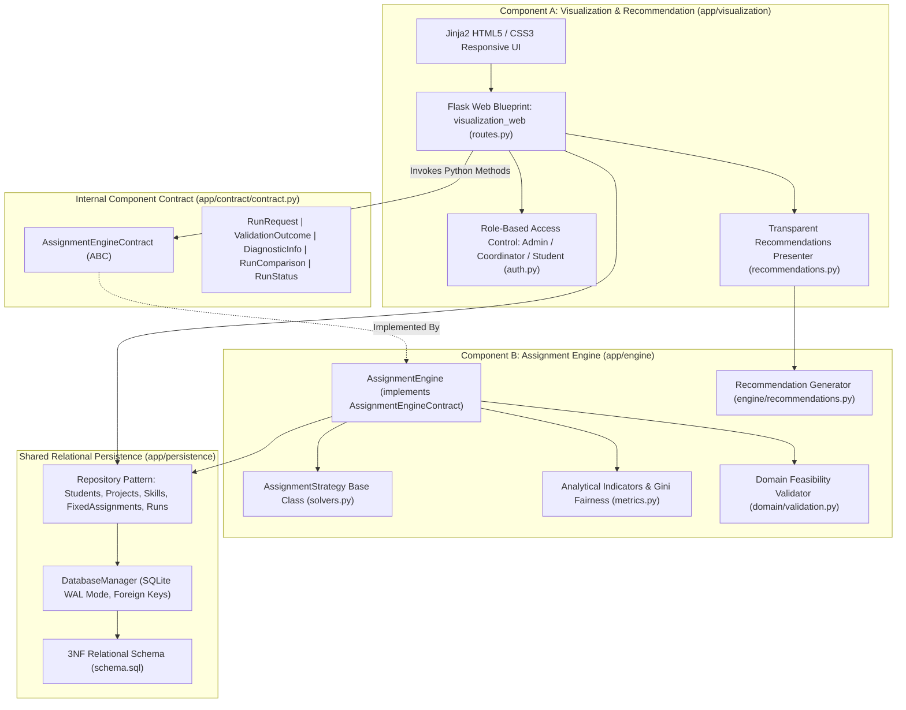
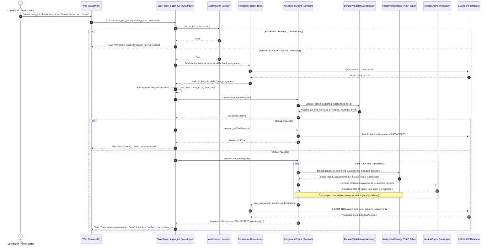
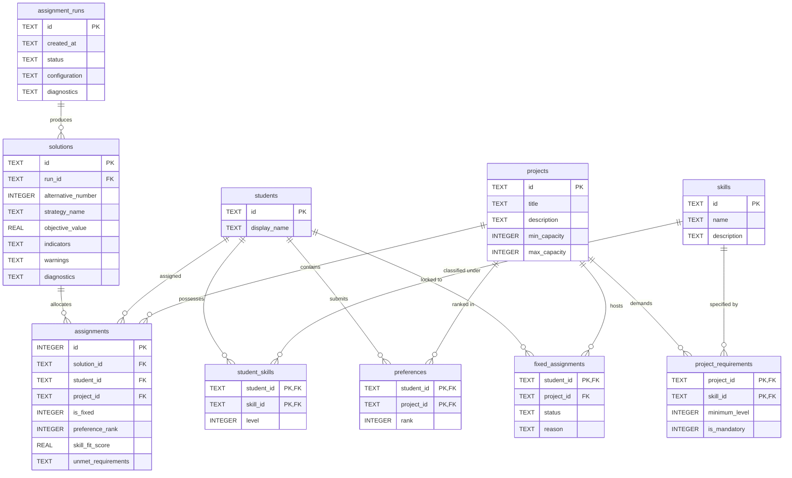

# Deliverable 3: System Architecture Specification & Design Rationale

## 1. Executive Architectural Overview

The **TECH5 Student-to-Project Assignment Decision Support System (DSS)** is an integrated application engineered for the Norwegian School of Economics (NHH). It solves the complex combinatorial allocation problem of assigning a cohort of students to semester research and consulting projects based on multidimensional criteria: **student ranked preferences**, **student skill proficiencies**, **project skill requirements**, **project capacity bounds**, and **administrative pre-allocation locks**.

In accordance with the project specification (Sections 5, 7, 8, and 15), the system is architected as **two decoupled, modular application components** running within a single integrated Python runtime:

1. **Component A (Visualization & Recommendation Component)** (`app/visualization`):
   - Manages user workflows, cohort data inspection, CRUD forms, benchmark scenario seeding, role switching (Course Administrator, Program Coordinator, Student Viewer), multi-solution visual side-by-side trade-off comparisons, and evidence-backed recommendations.
2. **Component B (Assignment Engine)** (`app/engine`):
   - Validates cohort feasibility, executes mathematical optimization using the **Strategy Pattern** (`AssignmentStrategy`), generates distinct Pareto alternatives via integer no-good cuts, evaluates multidimensional quality and fairness metrics (e.g. Gini coefficient, mean rank, skill fit), and captures execution diagnostics.

The two components are mediated strictly by an **internal Python component contract** (`app/contract/contract.py`), backed by a shared relational SQLite 3NF persistence layer (`app/persistence`).

---

## 2. Component Diagram & Internal Interface

---

## 3. Design Rationale: Why We Designed It This Way

When designing the TECH5 Decision Support System, we made four deliberate architectural choices to balance academic rigor, operational simplicity, and software maintainability.

### 1. Two Decoupled Components Mediated by an In-Process Contract
We separated the application into two distinct halves: Component A (Visualization & Recommendation) and Component B (Assignment Engine). Component A is responsible exclusively for presentation, user interaction, role-based views, and scenario exploration. Component B is a pure mathematical engine responsible for cohort validation, linear programming, and analytical indicators. Component B has zero dependencies on Flask, cookies, or HTML templates. All communication crosses a single abstract Python interface (`AssignmentEngineContract`) using strongly typed data transfer objects (`RunRequest`, `ValidationOutcome`, `RunComparison`). This separation means Team B can develop and test complex solvers in headless Python scripts without running a web server, while Team A can build and refine UI templates independently using a mock engine.

### 2. In-Process Monolith Over Networked Microservices
While a microservice architecture might seem appealing on paper, splitting a single-server educational tool across HTTP REST APIs introduces unnecessary complexity. Networked services require port configuration, HTTP serialization/deserialization, error code translation, retry logic, and latency overhead. By hosting both components within a single Python runtime, method calls are instantaneous and type-checked at compile time. Data structures pass by reference without JSON round-tripping, avoiding subtle schema drift bugs while maintaining clean architectural boundaries.

### 3. Repository Pattern for Centralized Relational Persistence
Rather than embedding SQL queries inside Flask route functions or optimization solvers, every database transaction is encapsulated in dedicated repositories (`StudentRepository`, `ProjectRepository`, `RunRepository`, etc.). This cleanly decouples business rules from the underlying SQLite schema. The repositories enforce relational integrity, handle JSON serialization for complex indicator fields, and leverage SQLite foreign keys (`PRAGMA foreign_keys = ON`) with cascading deletes. If the university ever migrates from SQLite to PostgreSQL, only the repository layer needs modification; the rest of the application remains untouched.

### 4. Strategy Pattern for Flexible Optimization Objectives
Different academic stakeholders prioritize competing goals: some favor student preference satisfaction, others prioritize project skill coverage, while committees seek balanced fairness. Using the Strategy Pattern (`AssignmentStrategy`), each optimization algorithm is encapsulated in a dedicated subclass. The engine orchestrates inputs, enforces capacity constraints, generates distinct Pareto alternatives via integer no-good cuts, and calculates fairness metrics without knowing the mathematical details of any specific objective function. Adding a new solver requires writing one new class without modifying existing engine logic.

---

## 4. UML Class Diagram (Domain, Contract, and Engine)

The following diagram reflects the exact class names, attributes, and method signatures defined in `app/domain/models.py`, `app/contract/contract.py`, and `app/engine/solvers.py`:

```mermaid
classDiagram
    direction TB

    class Skill {
        +str id
        +str name
        +str description
        +to_dict() dict
        +from_dict(data)$ Skill
    }

    class ProjectRequirement {
        +str project_id
        +str skill_id
        +int minimum_level
        +bool is_mandatory
        +to_dict() dict
        +from_dict(data)$ ProjectRequirement
    }

    class Preference {
        +str student_id
        +str project_id
        +int rank
        +to_dict() dict
        +from_dict(data)$ Preference
    }

    class Student {
        +str id
        +str display_name
        +dict~str, int~ skills
        +list~Preference~ preferences
        +get_preference_rank(project_id) int?
        +get_skill_level(skill_id) int
        +to_dict() dict
        +from_dict(data)$ Student
    }

    class Project {
        +str id
        +str title
        +int min_capacity
        +int max_capacity
        +str description
        +list~ProjectRequirement~ requirements
        +get_requirement(skill_id) ProjectRequirement?
        +get_mandatory_requirements() list~ProjectRequirement~
        +to_dict() dict
        +from_dict(data)$ Project
    }

    class FixedAssignment {
        +str student_id
        +str project_id
        +str status
        +str reason
        +to_dict() dict
        +from_dict(data)$ FixedAssignment
    }

    class Assignment {
        +str student_id
        +str project_id
        +bool is_fixed
        +int? preference_rank
        +float skill_fit_score
        +list~str~ unmet_requirements
        +to_dict() dict
        +from_dict(data)$ Assignment
    }

    class Solution {
        +str id
        +str run_id
        +int alternative_number
        +str strategy_name
        +float? objective_value
        +list~Assignment~ assignments
        +dict indicators
        +list~str~ warnings
        +dict diagnostics
        +get_assignment_for_student(student_id) Assignment?
        +to_dict() dict
        +from_dict(data)$ Solution
    }

    class AssignmentRun {
        +str id
        +str created_at
        +str status
        +dict configuration
        +list~Solution~ solutions
        +dict diagnostics
        +to_dict() dict
        +from_dict(data)$ AssignmentRun
    }

    class RunComparison {
        +str solution_a_id
        +int solution_a_alt
        +str solution_b_id
        +int solution_b_alt
        +dict delta_metrics
        +list~dict~ changed_assignments
        +int changed_students_count
        +int total_students
        +bool is_distinct
        +int rank_improved_count
        +int rank_worsened_count
        +float delta_mean_skill_fit
        +float delta_mean_rank
        +int delta_unranked_count
        +list~str~ trade_off_summary
        +to_dict() dict
        +from_dict(data)$ RunComparison
    }

    class RunRequest {
        +list~Student~ students
        +list~Project~ projects
        +list~Skill~? skills
        +list~FixedAssignment~? fixed_assignments
        +str strategy_key
        +int max_alternatives
        +str notes
    }

    class ValidationOutcome {
        +bool is_valid
        +bool is_feasible
        +list~str~ errors
        +list~str~ warnings
        +list~str~ infeasibility_reasons
        +to_dict() dict
    }

    class DiagnosticInfo {
        +str solver_status
        +float solve_time_seconds
        +int constraints_count
        +int variables_count
        +list~str~ infeasibility_reasons
        +dict additional_info
        +to_dict() dict
    }

    class AssignmentEngineContract {
        <<interface>>
        +validate_inputs(request)* ValidationOutcome
        +execute_run(request)* AssignmentRun
        +list_runs(limit)* list~AssignmentRun~
        +get_run(run_id)* AssignmentRun?
        +get_solution(solution_id)* Solution?
        +compare_solutions(solution_a_id, solution_b_id)* RunComparison
    }

    class AssignmentEngine {
        -RunRepository run_repo
        -dict strategies
        +validate_inputs(request) ValidationOutcome
        +execute_run(request) AssignmentRun
        +run_assignment(students, projects, ...) AssignmentRun
        +list_runs(limit) list~AssignmentRun~
        +get_run(run_id) AssignmentRun?
        +get_solution(solution_id) Solution?
        +compare_solutions(solution_a_id, solution_b_id) RunComparison
    }

    class MockAssignmentEngine {
        -RunRepository run_repo
        +validate_inputs(request) ValidationOutcome
        +execute_run(request) AssignmentRun
        +list_runs(limit) list~AssignmentRun~
        +get_run(run_id) AssignmentRun?
        +get_solution(solution_id) Solution?
        +compare_solutions(solution_a_id, solution_b_id) RunComparison
    }

    class AssignmentStrategy {
        <<abstract>>
        +str name
        +str description
        +calculate_cost_or_utility(student, project, max_pref)* float
        +solve(students, projects, fixed_assignments, excluded)* tuple
    }

    Student "1" *-- "*" Preference
    Project "1" *-- "*" ProjectRequirement
    AssignmentRun "1" *-- "*" Solution
    Solution "1" *-- "*" Assignment
    AssignmentEngineContract <|.. AssignmentEngine
    AssignmentEngineContract <|.. MockAssignmentEngine
    AssignmentEngine o-- AssignmentStrategy
    AssignmentEngineContract ..> RunRequest : receives
    AssignmentEngineContract ..> ValidationOutcome : returns
    AssignmentEngineContract ..> RunComparison : produces
```

---

## 5. UML Sequence Diagram: "What Happens When I Click Run"

The sequence diagram below walks through the end-to-end execution flow when a coordinator or administrator clicks the **"Execute Optimization Solver"** button on the dashboard:

---

## 6. Relational Database Architecture (3NF Schema)

---

## 7. Role-Based Access Control (RBAC) & Action Matrix

The application models three explicit business roles in `app/visualization/auth.py`:
1. **Course Administrator (`ADMIN`)**: Full authorization. Can edit students, projects, skills, and fixed assignments, trigger optimization runs, and switch active roles.
2. **Program Coordinator (`COORDINATOR`)**: Operational authorization. Can manage fixed assignment locks, trigger solver runs, and inspect detailed recommendations and comparisons. Read-only on baseline student data.
3. **Student Viewer (`STUDENT`)**: Transparency view. Can browse anonymized dashboard metrics, project descriptions, and high-level allocation summaries. All mutating actions are disabled.

### Role × Action Permission Matrix

| System Action | Course Administrator (`ADMIN`) | Program Coordinator (`COORDINATOR`) | Student Viewer (`STUDENT`) | Authorization Guard |
| :--- | :---: | :---: | :---: | :--- |
| **View Dashboard & Catalog** | Yes | Yes | Yes | Public Read |
| **Manage Students (CRUD)** | Yes | Read-Only | Read-Only | `auth.can_edit_cohort_data()` |
| **Manage Projects (CRUD)** | Yes | Read-Only | Read-Only | `auth.can_edit_cohort_data()` |
| **Manage Skills (CRUD)** | Yes | Read-Only | Read-Only | `auth.can_edit_cohort_data()` |
| **Seed Benchmark Scenarios** | Yes | Read-Only | Read-Only | `auth.can_edit_cohort_data()` |
| **Trigger Optimization Solver** | Yes | Yes | No | `auth.can_trigger_optimization()` |
| **Lock Assignment & Re-Run** | Yes | Yes | No | `auth.can_trigger_optimization()` |
| **Inspect Solutions & Details** | Yes | Yes | Yes | Public Read |
| **Side-by-Side Comparison** | Yes | Yes | Yes | Public Read |
| **Inspect Recommendations** | Yes | Yes | Yes | Public Read |
| **Switch Role in Session** | Yes | Yes | Yes | Interactive Prototype Utility |
