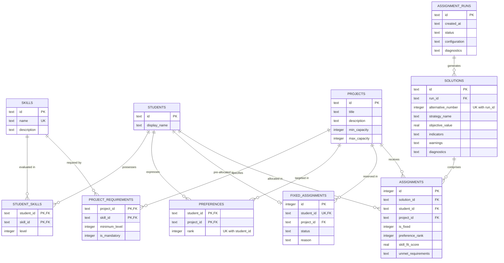

# TECH5 Assignment Support System: Relational Database Design Specification

## 1. Relational Data Architecture Overview

The persistence architecture of the TECH5 Decision Support System is implemented as a **Third Normal Form (3NF)** relational database in SQLite. It provides atomic transactions, cascading referential integrity, and high-performance querying for both transactional updates (CRUD) and analytical aggregations (evaluation indicators and historical audits).

### Core Database Configuration
- **SQLite Version**: SQLite 3 (supported in standard Python `sqlite3`).
- **Journal Mode**: `WAL` (Write-Ahead Logging) for non-blocking concurrent reads during optimization persistence.
- **Foreign Key Enforcement**: Explicitly activated upon every connection (`PRAGMA foreign_keys = ON;`).
- **Encoding**: UTF-8 with standard collation.

---

## 2. Entity-Relationship (ER) Diagram



---

## 3. Relational Table Definitions & Constraints

### 3.1 `skills` (Skills Catalog)
Stores the standardized taxonomy of technical and domain competencies:
```sql
CREATE TABLE IF NOT EXISTS skills (
    id TEXT PRIMARY KEY,
    name TEXT NOT NULL UNIQUE,
    description TEXT DEFAULT ''
);
```

### 3.2 `students` (Student Roster)
Stores student identification:
```sql
CREATE TABLE IF NOT EXISTS students (
    id TEXT PRIMARY KEY,
    display_name TEXT NOT NULL
);
```

### 3.3 `projects` (Project Catalog & Capacities)
Enforces capacity domain integrity rules directly at the schema layer:
```sql
CREATE TABLE IF NOT EXISTS projects (
    id TEXT PRIMARY KEY,
    title TEXT NOT NULL,
    description TEXT DEFAULT '',
    min_capacity INTEGER NOT NULL DEFAULT 0 CHECK(min_capacity >= 0),
    max_capacity INTEGER NOT NULL CHECK(max_capacity >= 1),
    CHECK(min_capacity <= max_capacity)
);
```

### 3.4 `student_skills` (Student Proficiency Matrix)
Resolves many-to-many relationship between students and skills:
```sql
CREATE TABLE IF NOT EXISTS student_skills (
    student_id TEXT NOT NULL,
    skill_id TEXT NOT NULL,
    level INTEGER NOT NULL DEFAULT 1 CHECK(level >= 1),
    PRIMARY KEY (student_id, skill_id),
    FOREIGN KEY (student_id) REFERENCES students(id) ON DELETE CASCADE,
    FOREIGN KEY (skill_id) REFERENCES skills(id) ON DELETE CASCADE
);
```

### 3.5 `project_requirements` (Project Skill Requirements)
Specifies minimum required competency level and mandatory flags:
```sql
CREATE TABLE IF NOT EXISTS project_requirements (
    project_id TEXT NOT NULL,
    skill_id TEXT NOT NULL,
    minimum_level INTEGER NOT NULL DEFAULT 1 CHECK(minimum_level >= 1),
    is_mandatory INTEGER NOT NULL DEFAULT 0 CHECK(is_mandatory IN (0, 1)),
    PRIMARY KEY (project_id, skill_id),
    FOREIGN KEY (project_id) REFERENCES projects(id) ON DELETE CASCADE,
    FOREIGN KEY (skill_id) REFERENCES skills(id) ON DELETE CASCADE
);
```

### 3.6 `preferences` (Student Ranked Preferences)
Prevents duplicate project preference ranking for the same student via composite unique constraint `uq_student_rank`:
```sql
CREATE TABLE IF NOT EXISTS preferences (
    student_id TEXT NOT NULL,
    project_id TEXT NOT NULL,
    rank INTEGER NOT NULL CHECK(rank >= 1),
    PRIMARY KEY (student_id, project_id),
    FOREIGN KEY (student_id) REFERENCES students(id) ON DELETE CASCADE,
    FOREIGN KEY (project_id) REFERENCES projects(id) ON DELETE CASCADE,
    CONSTRAINT uq_student_rank UNIQUE (student_id, rank)
);
```

### 3.7 `fixed_assignments` (Administrative Pre-Allocations)
Guarantees at the schema level that a student can be locked to at most one project (`student_id TEXT NOT NULL UNIQUE`):
```sql
CREATE TABLE IF NOT EXISTS fixed_assignments (
    id INTEGER PRIMARY KEY AUTOINCREMENT,
    student_id TEXT NOT NULL UNIQUE,
    project_id TEXT NOT NULL,
    status TEXT NOT NULL DEFAULT 'APPROVED',
    reason TEXT DEFAULT '',
    FOREIGN KEY (student_id) REFERENCES students(id) ON DELETE CASCADE,
    FOREIGN KEY (project_id) REFERENCES projects(id) ON DELETE CASCADE
);
```

### 3.8 `assignment_runs` (Historical Execution Audit)
Audits optimization runs, input parameters, and solver logs:
```sql
CREATE TABLE IF NOT EXISTS assignment_runs (
    id TEXT PRIMARY KEY,
    created_at TEXT NOT NULL,
    status TEXT NOT NULL,
    configuration TEXT NOT NULL,
    diagnostics TEXT NOT NULL
);
```

### 3.9 `solutions` (Alternative Feasible Solutions)
Guarantees unique alternative numbering within an optimization run:
```sql
CREATE TABLE IF NOT EXISTS solutions (
    id TEXT PRIMARY KEY,
    run_id TEXT NOT NULL,
    alternative_number INTEGER NOT NULL,
    strategy_name TEXT NOT NULL,
    objective_value REAL,
    indicators TEXT NOT NULL,
    warnings TEXT NOT NULL,
    diagnostics TEXT NOT NULL,
    FOREIGN KEY (run_id) REFERENCES assignment_runs(id) ON DELETE CASCADE,
    CONSTRAINT uq_run_alternative UNIQUE (run_id, alternative_number)
);
```

### 3.10 `assignments` (Detailed Student Allocations)
Stores the individual match tuples. Guarantees that within a solution, a student is assigned to exactly one project (`uq_solution_student`):
```sql
CREATE TABLE IF NOT EXISTS assignments (
    id INTEGER PRIMARY KEY AUTOINCREMENT,
    solution_id TEXT NOT NULL,
    student_id TEXT NOT NULL,
    project_id TEXT NOT NULL,
    is_fixed INTEGER NOT NULL DEFAULT 0 CHECK(is_fixed IN (0, 1)),
    preference_rank INTEGER,
    skill_fit_score REAL NOT NULL DEFAULT 0.0,
    unmet_requirements TEXT DEFAULT '[]',
    FOREIGN KEY (solution_id) REFERENCES solutions(id) ON DELETE CASCADE,
    FOREIGN KEY (student_id) REFERENCES students(id) ON DELETE CASCADE,
    FOREIGN KEY (project_id) REFERENCES projects(id) ON DELETE CASCADE,
    CONSTRAINT uq_solution_student UNIQUE (solution_id, student_id)
);
```

### 3.11 Performance Indexes
Secondary indexes on the foreign-key columns used by the joins in section 5:
```sql
CREATE INDEX IF NOT EXISTS idx_student_skills_skill ON student_skills(skill_id);
CREATE INDEX IF NOT EXISTS idx_project_requirements_skill ON project_requirements(skill_id);
CREATE INDEX IF NOT EXISTS idx_preferences_project ON preferences(project_id);
CREATE INDEX IF NOT EXISTS idx_solutions_run ON solutions(run_id);
CREATE INDEX IF NOT EXISTS idx_assignments_solution ON assignments(solution_id);
CREATE INDEX IF NOT EXISTS idx_assignments_project ON assignments(project_id);
CREATE INDEX IF NOT EXISTS idx_runs_created_at ON assignment_runs(created_at DESC);
```

---

## 4. Third Normal Form (3NF) Justification

The relational design satisfies all conditions of 3NF:

1. **First Normal Form (1NF)**:
   - All column values are atomic (e.g. skills and preferences are broken into discrete relational rows rather than comma-separated strings).
   - Every table possesses a well-defined primary key.
2. **Second Normal Form (2NF)**:
   - Meets 1NF.
   - Every non-key attribute is fully functionally dependent on the entire primary key:
     - In `student_skills(student_id, skill_id)`, `level` depends on both the student and the skill.
     - In `project_requirements(project_id, skill_id)`, `minimum_level` and `is_mandatory` depend on both the project and the skill.
     - In `preferences(student_id, project_id)`, `rank` depends on the pair.
3. **Third Normal Form (3NF)**:
   - Meets 2NF.
   - No transitive functional dependencies exist ($X \to Y \to Z$).
   - Auxiliary entity attributes (such as skill descriptions, student display names, project capacities) are stored exclusively in their parent entity tables and referenced via foreign keys, eliminating update and deletion anomalies.

---

## 5. Analytical SQL Queries with Real Results

All eight queries live in [`app/persistence/queries.sql`](../app/persistence/queries.sql); the SQL below is copied from that file. Queries 7 and 8 were added for this deliverable.

**How the results were produced.** For each scenario we started the app with an empty database, clicked *Load scenario* (Standard, Fixed Assignment or Capacity Deficit) and *Run optimisation* (strategy `PREFERENCE`, 2 alternatives), then ran every query against the same SQLite file. `:solution_id` is alternative 1 of that run. Solution and run IDs are random UUIDs, so they are shortened (`eaafaaf5…`) and will differ on your machine; all other values are reproducible.

> **Important:** Team B's engine is not finished yet, so these runs were produced by `MockAssignmentEngine`. The *queries* are final, but the solution-dependent numbers (queries 1–7) must be re-run after the real engine is swapped in (issue X1). Query 8 uses only input data and will not change.

### 5.1 Full Solution Assignments View

**SQL techniques:** Multi-table `JOIN` and filtering by solution.

**Purpose:** Lists every student in one solution with their project, rank, skill-fit score and unmet requirements. This is the table behind the solution detail page.

```sql
SELECT
    a.solution_id,
    s.id AS student_id,
    s.display_name AS student_name,
    p.id AS project_id,
    p.title AS project_title,
    a.is_fixed,
    a.preference_rank,
    a.skill_fit_score,
    a.unmet_requirements
FROM assignments a
JOIN students s ON a.student_id = s.id
JOIN projects p ON a.project_id = p.id
WHERE a.solution_id = :solution_id
ORDER BY a.preference_rank IS NULL, a.preference_rank ASC, s.display_name ASC;
```

**Result (Standard scenario):**

| solution_id | student_id | student_name | project_id | project_title | is_fixed | preference_rank | skill_fit_score | unmet_requirements |
|---|---|---|---|---|---|---|---|---|
| eaafaaf5… | S04 | David Nygard | P4 | Smart City Mobility Portal | 0 | 1 | 0.85 | [] |
| eaafaaf5… | S05 | Emma Lind | P1 | Sustainable FinTech Risk Engine | 0 | 1 | 0.85 | [] |
| eaafaaf5… | S07 | Greta Hansen | P3 | Healthcare Predictive ML Assistant | 0 | 1 | 0.85 | [] |
| eaafaaf5… | S08 | Henrik Olsen | P4 | Smart City Mobility Portal | 0 | 1 | 0.85 | [] |
| eaafaaf5… | S06 | Fredrik Berg | P2 | Cloud Data Pipeline & Lakehouse | 0 | 2 | 0.85 | [] |
| eaafaaf5… | S09 | Ingrid Solberg | P1 | Sustainable FinTech Risk Engine | 0 | 2 | 0.85 | [] |
| eaafaaf5… | S01 | Alice Chen | P1 | Sustainable FinTech Risk Engine | 0 | 3 | 0.85 | [] |
| eaafaaf5… | S02 | Bob Smith | P2 | Cloud Data Pipeline & Lakehouse | 0 | 3 | 0.85 | [] |
| eaafaaf5… | S03 | Clara Holm | P3 | Healthcare Predictive ML Assistant | 0 | 3 | 0.85 | [] |
| eaafaaf5… | S10 | Jonas Dale | P2 | Cloud Data Pipeline & Lakehouse | 0 | 3 | 0.85 | [] |

**What it shows:** All 10 students of the Standard cohort are placed. The `skill_fit_score` is the same (0.85) for everyone and `unmet_requirements` is always `[]`: these are placeholder values written by the mock engine, not real calculations (see section 6).

### 5.2 Project Capacity Utilization

**SQL techniques:** `LEFT JOIN`, `GROUP BY`, `COUNT`, `CASE`.

**Purpose:** Compares the number of students placed in each project with its minimum and maximum seats.

```sql
SELECT
    p.id AS project_id,
    p.title AS project_title,
    p.min_capacity,
    p.max_capacity,
    COUNT(a.id) AS assigned_count,
    ROUND(COUNT(a.id) * 100.0 / p.max_capacity, 1) AS utilization_percentage,
    (p.max_capacity - COUNT(a.id)) AS remaining_seats,
    CASE
        WHEN COUNT(a.id) > p.max_capacity THEN 'OVER_CAPACITY'
        WHEN COUNT(a.id) < p.min_capacity THEN 'UNDER_MINIMUM'
        WHEN COUNT(a.id) = p.max_capacity THEN 'FULL'
        ELSE 'AVAILABLE'
    END AS capacity_status
FROM projects p
LEFT JOIN assignments a ON p.id = a.project_id AND a.solution_id = :solution_id
GROUP BY p.id, p.title, p.min_capacity, p.max_capacity
ORDER BY utilization_percentage DESC;
```

**Result (Standard scenario):**

| project_id | project_title | min_capacity | max_capacity | assigned_count | utilization_percentage | remaining_seats | capacity_status |
|---|---|---|---|---|---|---|---|
| P1 | Sustainable FinTech Risk Engine | 1 | 3 | 3 | 100 | 0 | FULL |
| P2 | Cloud Data Pipeline & Lakehouse | 1 | 3 | 3 | 100 | 0 | FULL |
| P3 | Healthcare Predictive ML Assistant | 1 | 3 | 2 | 66.7 | 1 | AVAILABLE |
| P4 | Smart City Mobility Portal | 1 | 3 | 2 | 66.7 | 1 | AVAILABLE |

**What it shows:** P1 and P2 are full (3 of 3 seats), P3 and P4 have one free seat each. Every project reaches its minimum of 1, so no project would be cancelled.

### 5.3 Preference Satisfaction Distribution

**SQL techniques:** aggregation with a scalar subquery for the percentage.

**Purpose:** Counts how many students received their 1st, 2nd, 3rd choice or a project they did not rank.

```sql
SELECT
    COALESCE(CAST(a.preference_rank AS TEXT), 'Unranked / Outside Preference') AS rank_bucket,
    COUNT(a.id) AS student_count,
    ROUND(COUNT(a.id) * 100.0 / (SELECT COUNT(*) FROM assignments WHERE solution_id = :solution_id), 1) AS percentage_of_cohort
FROM assignments a
WHERE a.solution_id = :solution_id
GROUP BY a.preference_rank
ORDER BY a.preference_rank IS NULL, a.preference_rank ASC;
```

**Result (Standard scenario):**

| rank_bucket | student_count | percentage_of_cohort |
|---|---|---|
| 1 | 4 | 40 |
| 2 | 2 | 20 |
| 3 | 4 | 40 |

**What it shows:** The query reports 4 first choices, 2 second and 4 third choices. Query 7 shows that 2 of the "first choices" are really unranked projects, so the true split is 2 / 2 / 4 plus 2 unranked (section 6).

### 5.4 Unmet Skill Requirements (Competence Gap)

**SQL techniques:** four `JOIN`s, `LEFT JOIN` + `COALESCE` for missing skills.

**Purpose:** Finds students whose skill level is below what their project requires; a missing skill counts as level 0.

```sql
SELECT
    a.solution_id,
    s.id AS student_id,
    s.display_name AS student_name,
    p.id AS project_id,
    p.title AS project_title,
    pr.skill_id,
    sk.name AS skill_name,
    pr.minimum_level AS required_level,
    COALESCE(ss.level, 0) AS student_level,
    (pr.minimum_level - COALESCE(ss.level, 0)) AS skill_deficit,
    pr.is_mandatory
FROM assignments a
JOIN students s ON a.student_id = s.id
JOIN projects p ON a.project_id = p.id
JOIN project_requirements pr ON p.id = pr.project_id
JOIN skills sk ON pr.skill_id = sk.id
LEFT JOIN student_skills ss ON s.id = ss.student_id AND pr.skill_id = ss.skill_id
WHERE a.solution_id = :solution_id
  AND COALESCE(ss.level, 0) < pr.minimum_level
ORDER BY pr.is_mandatory DESC, skill_deficit DESC;
```

**Result (Standard scenario):**

| solution_id | student_id | student_name | project_id | project_title | skill_id | skill_name | required_level | student_level | skill_deficit | is_mandatory |
|---|---|---|---|---|---|---|---|---|---|---|
| eaafaaf5… | S01 | Alice Chen | P1 | Sustainable FinTech Risk Engine | fintech | Financial Modeling | 3 | 0 | 3 | 0 |
| eaafaaf5… | S03 | Clara Holm | P3 | Healthcare Predictive ML Assistant | ml | Machine Learning | 3 | 0 | 3 | 0 |
| eaafaaf5… | S07 | Greta Hansen | P3 | Healthcare Predictive ML Assistant | ml | Machine Learning | 3 | 0 | 3 | 0 |
| eaafaaf5… | S08 | Henrik Olsen | P4 | Smart City Mobility Portal | web | Full-Stack Web Dev | 3 | 0 | 3 | 0 |
| eaafaaf5… | S09 | Ingrid Solberg | P1 | Sustainable FinTech Risk Engine | fintech | Financial Modeling | 3 | 0 | 3 | 0 |
| eaafaaf5… | S07 | Greta Hansen | P3 | Healthcare Predictive ML Assistant | python | Python Programming | 3 | 1 | 2 | 0 |
| eaafaaf5… | S02 | Bob Smith | P2 | Cloud Data Pipeline & Lakehouse | sql | SQL & Data Modeling | 3 | 2 | 1 | 0 |
| eaafaaf5… | S10 | Jonas Dale | P2 | Cloud Data Pipeline & Lakehouse | sql | SQL & Data Modeling | 3 | 2 | 1 | 0 |

**What it shows:** 8 skill gaps in 7 placements. None of them is mandatory (`is_mandatory = 0`, all Standard requirements are nice-to-have), so the solution is still allowed. The largest gaps (deficit 3) are students who do not have the skill at all, e.g. Alice Chen (S01) in the FinTech project without any Financial Modeling skill.

### 5.5 Fixed Assignment Integrity Audit

**SQL techniques:** `LEFT JOIN` anti-join pattern with `CASE`.

**Purpose:** Checks that every locked (fixed) student really ended up in the locked project.

```sql
SELECT
    fa.student_id,
    fa.project_id AS required_project_id,
    fa.reason,
    a.project_id AS actual_project_id,
    CASE
        WHEN a.project_id = fa.project_id THEN 'HONORED'
        WHEN a.project_id IS NULL THEN 'UNASSIGNED'
        ELSE 'VIOLATED'
    END AS compliance_status
FROM fixed_assignments fa
LEFT JOIN assignments a ON fa.student_id = a.student_id AND a.solution_id = :solution_id;
```

**Result (Fixed Assignment scenario):**

| student_id | required_project_id | reason | actual_project_id | compliance_status |
|---|---|---|---|---|
| S02 | P2 | Pre-arranged research grant fellowship on cloud data pipelines. | P2 | HONORED |

**What it shows:** Run on the **Fixed Assignment** scenario, because the Standard scenario has no locks (the query returns no rows there). The one lock, Bob Smith (S02) in P2, is `HONORED`.

### 5.6 Historical Runs Overview

**SQL techniques:** `LEFT JOIN`, `GROUP BY`, `ORDER BY` + `LIMIT`.

**Purpose:** Lists past optimisation runs with their status and number of alternative solutions.

```sql
SELECT
    r.id AS run_id,
    r.created_at,
    r.status,
    COUNT(s.id) AS alternative_solutions_count,
    r.configuration
FROM assignment_runs r
LEFT JOIN solutions s ON r.id = s.run_id
GROUP BY r.id, r.created_at, r.status, r.configuration
ORDER BY r.created_at DESC
LIMIT 25;
```

**Result (Standard scenario):**

| run_id | created_at | status | alternative_solutions_count | configuration |
|---|---|---|---|---|
| a317fc85… | 2026-10-26T11:28:39.695190+00:00 | COMPLETED | 2 | {"max_alternatives": 2, "primary_strategy": "PREFERENCE", "engine": "MockAssignmentEngine"} |

**What it shows:** One completed run with 2 alternatives. The stored configuration shows which engine produced it (`MockAssignmentEngine`).

### 5.7 Students Assigned to a Project They Did Not Rank (new)

**SQL techniques:** anti-join (`LEFT JOIN ... WHERE ... IS NULL`) and a correlated subquery.

**Purpose:** Finds students placed in a project that is not on their own preference list. It checks the `preferences` table directly instead of trusting the `preference_rank` copied into `assignments`.

```sql
SELECT
    s.id AS student_id,
    s.display_name AS student_name,
    a.project_id AS assigned_project_id,
    p.title AS assigned_project_title,
    a.is_fixed,
    (SELECT COUNT(*) FROM preferences x WHERE x.student_id = s.id)
        AS projects_ranked_by_student
FROM assignments a
JOIN students s ON a.student_id = s.id
JOIN projects p ON a.project_id = p.id
LEFT JOIN preferences pr
    ON pr.student_id = a.student_id AND pr.project_id = a.project_id
WHERE a.solution_id = :solution_id
  AND pr.project_id IS NULL
ORDER BY a.is_fixed DESC, s.id ASC;
```

**Result (Standard scenario):**

| student_id | student_name | assigned_project_id | assigned_project_title | is_fixed | projects_ranked_by_student |
|---|---|---|---|---|---|
| S07 | Greta Hansen | P3 | Healthcare Predictive ML Assistant | 0 | 3 |
| S08 | Henrik Olsen | P4 | Smart City Mobility Portal | 0 | 3 |

**What it shows:** Greta Hansen (S07) and Henrik Olsen (S08) are placed in projects they never ranked, although query 1 shows rank 1 for both. This query found a real data-quality problem in the mock engine (section 6).

### 5.8 Project Demand vs. Supply Before Optimisation (new)

**SQL techniques:** conditional aggregation (`SUM(CASE ...)`), `AVG`, `LEFT JOIN`.

**Purpose:** Uses only input data (preferences and seats), so the coordinator can spot over-subscribed projects before running the engine.

```sql
SELECT
    p.id AS project_id,
    p.title AS project_title,
    p.max_capacity,
    SUM(CASE WHEN pr.rank = 1 THEN 1 ELSE 0 END) AS first_choice_count,
    COUNT(pr.student_id) AS times_ranked,
    ROUND(AVG(pr.rank), 2) AS average_rank,
    ROUND(
        SUM(CASE WHEN pr.rank = 1 THEN 1 ELSE 0 END) * 1.0 / p.max_capacity,
        2
    ) AS first_choice_per_seat,
    CASE
        WHEN SUM(CASE WHEN pr.rank = 1 THEN 1 ELSE 0 END) > p.max_capacity
            THEN 'OVERSUBSCRIBED'
        WHEN COUNT(pr.student_id) = 0 THEN 'NOT_RANKED'
        ELSE 'OK'
    END AS demand_status
FROM projects p
LEFT JOIN preferences pr ON pr.project_id = p.id
GROUP BY p.id, p.title, p.max_capacity
ORDER BY first_choice_per_seat DESC, times_ranked DESC;
```

**Result (Standard scenario):**

| project_id | project_title | max_capacity | first_choice_count | times_ranked | average_rank | first_choice_per_seat | demand_status |
|---|---|---|---|---|---|---|---|
| P1 | Sustainable FinTech Risk Engine | 3 | 3 | 8 | 2 | 1 | OK |
| P3 | Healthcare Predictive ML Assistant | 3 | 3 | 7 | 1.86 | 1 | OK |
| P4 | Smart City Mobility Portal | 3 | 3 | 7 | 1.86 | 1 | OK |
| P2 | Cloud Data Pipeline & Lakehouse | 3 | 1 | 8 | 2.25 | 0.33 | OK |

**What it shows:** In the Standard scenario no project is over-subscribed: at most 3 first choices for 3 seats. P2 is the least popular (only 1 first choice).

**Result (Capacity Deficit scenario):**

| project_id | project_title | max_capacity | first_choice_count | times_ranked | average_rank | first_choice_per_seat | demand_status |
|---|---|---|---|---|---|---|---|
| P3 | Healthcare Predictive ML Assistant | 1 | 3 | 7 | 1.86 | 3 | OVERSUBSCRIBED |
| P4 | Smart City Mobility Portal | 1 | 3 | 7 | 1.86 | 3 | OVERSUBSCRIBED |
| P1 | Sustainable FinTech Risk Engine | 2 | 3 | 8 | 2 | 1.5 | OVERSUBSCRIBED |
| P2 | Cloud Data Pipeline & Lakehouse | 2 | 1 | 8 | 2.25 | 0.5 | OK |

**What it shows:** three of four projects are over-subscribed and the projects offer only 6 seats in total (1 + 1 + 2 + 2) for 10 students. This explains, before any solver runs, why the engine reports this scenario as infeasible and stores no solution (queries 1–7 return no rows here).

---

## 6. Findings for the Team

Running the queries on real data gave three findings that are useful beyond this document:

1. **The mock engine writes wrong preference ranks.** In `MockAssignmentEngine.execute_run` (`app/contract/mocks.py`) an unranked project gets `preference_rank = 1` (`get_preference_rank(...) or 1`). Query 7 exposes this: S07 and S08 are shown as "1st choice" in queries 1 and 3, but they never ranked their projects. *Action:* check that the real `AssignmentEngine` stores `NULL` for unranked projects; queries 3 and 7 must then agree.
2. **Skill fit and unmet requirements are placeholders.** The mock writes `skill_fit_score = 0.85` and `unmet_requirements = []` for everyone, while query 4 finds 8 real skill gaps. *Action:* after X1, query 4 and the `unmet_requirements` column should list the same gaps (B1/B3).
3. **Infeasibility can be predicted from input data.** Query 8 shows the Capacity Deficit scenario has fewer seats than students, which matches the engine's INFEASIBLE result. This query can support the diagnostics message (B3.3).

---

## 7. Documentation vs. Schema Check

`docs/database_design.md` was compared table by table with [`app/persistence/schema.sql`](../app/persistence/schema.sql):

| Item | Result |
|---|---|
| 10 tables, columns, types, defaults | Match the schema exactly. |
| Primary keys, foreign keys, `ON DELETE CASCADE` | Match. Note: deleting a project also deletes the students' preferences for it and its old assignments; the app now reports how many preferences were removed (issue A1.2). |
| `CHECK` constraints (levels ≥ 1, `min_capacity ≤ max_capacity`, `max_capacity ≥ 1`, flags in (0, 1)) | Match. The web forms now give friendly messages for the same rules before SQLite would reject them (issue A1.3). |
| `PRAGMA foreign_keys = ON` and WAL mode (section 1) | Match `DatabaseManager.get_connection` in `database.py`. |
| ER diagram `UK` on `preferences.rank` and `solutions.alternative_number` | Clarified: these are **composite** unique keys, `(student_id, rank)` and `(run_id, alternative_number)`, not unique columns. |
| Indexes | Were missing from this document; added as section 3.11. |
| Section 5 queries | **Did not match `queries.sql`** (different columns and status labels, and one query that did not exist in the file). Section 5 now copies the SQL directly from `queries.sql`. |
