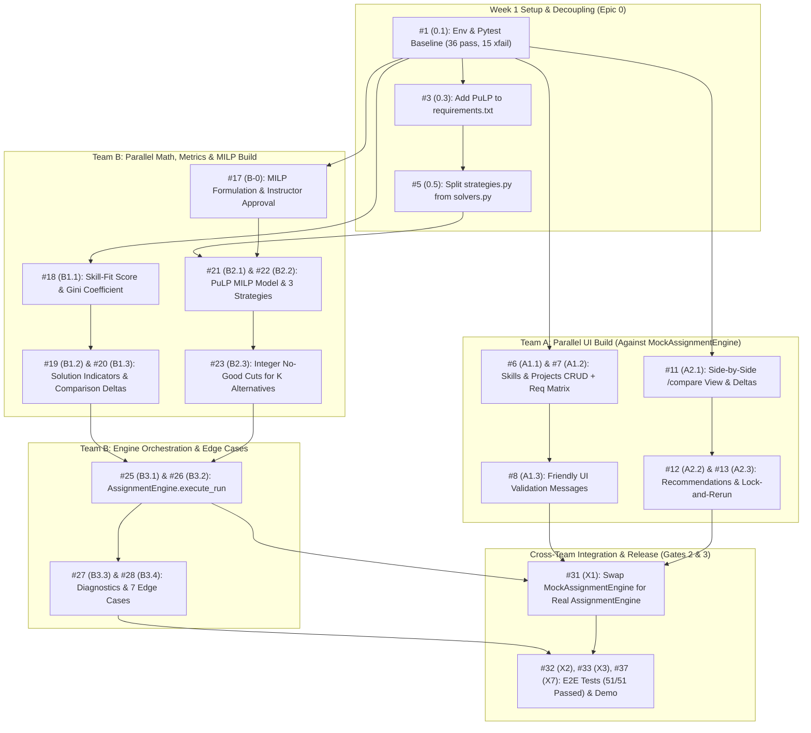
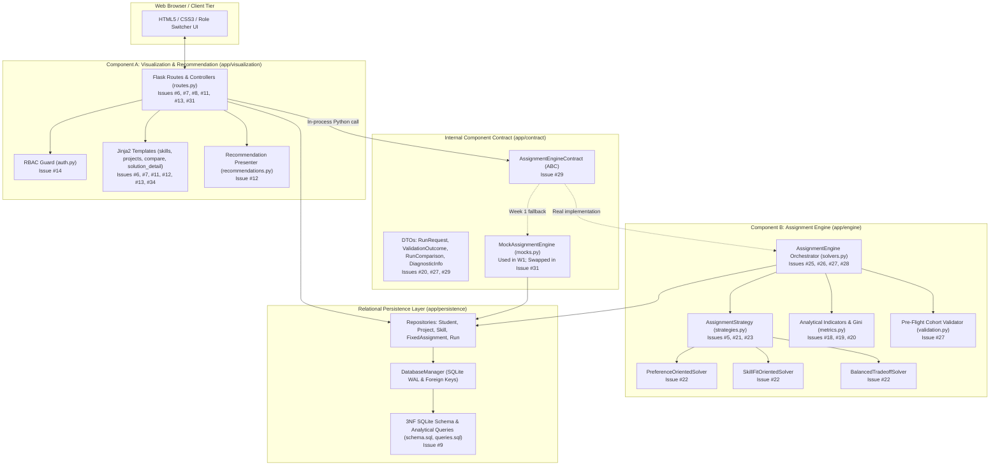
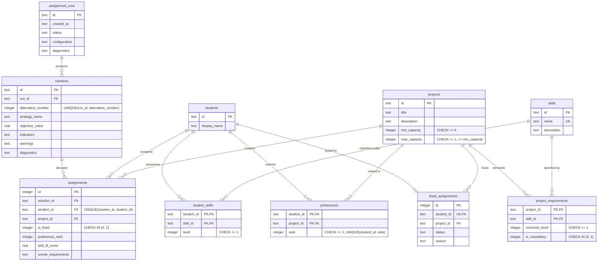

# Deliverable 1: Week 1 Progress Report & Work Plan

**Project:** TECH5 Collaborative Project   
**Team:** 6 (groups 3 and 17)  
**Repository:** [`mvs242430/TECH5-teams_3_17`](https://github.com/mvs242430/TECH5-teams_3_17)  
**Milestone:** Week 1 — *Understand, Design, and Divide*  

---

## 1. Week 1 Milestones & Progress Checklist

- [x] Starter repository cloned and virtual environment verified by all 5 team members ([Issue #1 / 0.1](https://github.com/mvs242430/TECH5-teams_3_17/issues/1)).
- [x] Reviewed SQLite 3NF schema ([`schema.sql`](../../app/persistence/schema.sql)) and component contract ([`AssignmentEngineContract`](../../app/contract/contract.py)).
- [x] Ran automated test suite and verified baseline state of 51 tests (`36 passed, 15 xfailed`).
- [x] Created onboarding documentation with UML class diagram, 3NF schema diagram, component diagram, and sequence diagram (see [`developer_onboarding_guide.md`](../team_related/developer_onboarding_guide.md)).
- [x] Established 3-week project work plan and allocated role responsibilities across all 5 team members.
- [x] Created and mapped 37 atomic GitHub issues from tasks allocated to each member.
- [x] Team B completed the MILP mathematical formulation, multi-strategy objectives, and fairness/efficiency indicator definitions.

---

## 2. Team Divisions & Role Responsibilities

The 5-person team is divided into two decoupled component sub-teams following the **Single Responsibility Principle**: closely coupled tasks (e.g., data forms + input validation, or MILP formulation + integer cuts) are assigned to the same specialist to prevent merge conflicts. *(Detailed task breakdowns and 37 atomic GitHub issue allocations across all three weeks are cataloged in the [Appendix](#appendix-three-week-work-plan--github-issue-allocation).)*

| Sub-Team | Member | Role Title | Primary Codebase Scope | Target `xfail` Tests Owned | Deliverable Lead |
| :--- | :--- | :--- | :--- | :--- | :--- |
| **Team A** *(Visualization & Recommendation)* | **Member A1** | **Data Management & Entity Specialist** | [`app/visualization/routes.py`](../../app/visualization/routes.py) (skills & projects CRUD), [`skills.html`](../../app/visualization/templates/skills.html), [`project_form.html`](../../app/visualization/templates/project_form.html), [`projects.html`](../../app/visualization/templates/projects.html) | `test_skills_crud_workflow`, `test_projects_crud_workflow` | **D1** (Progress Reports), **D5** (Database & SQL) |
| **Team A** *(Visualization & Recommendation)* | **Member A2** | **Decision Support, Comparison & UX Specialist** | [`app/visualization/routes.py`](../../app/visualization/routes.py) (`/compare`, `/runs`), [`compare.html`](../../app/visualization/templates/compare.html), [`recommendations.html`](../../app/visualization/templates/recommendations.html), [`solution_detail.html`](../../app/visualization/templates/solution_detail.html), [`auth.py`](../../app/visualization/auth.py) | `test_compare_solutions_view` | **D3** (Architecture), **D8** (Reproducible Demo) |
| **Team B** *(Assignment Engine)* | **Member B1** | **Analytical Indicators & Fairness Specialist** | [`app/engine/metrics.py`](../../app/engine/metrics.py), [`tests/test_metrics.py`](../../tests/test_metrics.py) | `test_skill_fit_calculation`, `test_gini_calculation`, `test_solution_indicators_calculation`, `test_solution_comparison` | **D6** (Analytical Note: Indicators & Fairness) |
| **Team B** *(Assignment Engine)* | **Member B2** | **Mathematical Optimization & Solvers Specialist** | `app/engine/strategies.py` (split via [#5](https://github.com/mvs242430/TECH5-teams_3_17/issues/5)), [`requirements.txt`](../../requirements.txt), [`tests/test_solvers.py`](../../tests/test_solvers.py) | `test_distinct_alternatives_generation` + MILP strategy tests | **D6** (Analytical Note: MILP Model), Method Approval |
| **Team B** *(Assignment Engine)* | **Member B3** | **Engine Orchestration, Diagnostics & Robustness Specialist** | [`app/engine/solvers.py`](../../app/engine/solvers.py) (`AssignmentEngine.execute_run`), [`app/domain/validation.py`](../../app/domain/validation.py), [`tests/test_edge_cases.py`](../../tests/test_edge_cases.py) | 7 solver edge cases in `test_edge_cases.py` (Cases 1–4, 13–15) | **D2** (Working App), **D4** (Contract Spec), **D7** (Testing Evidence) |
| **Shared** | **All** | **Full-Team Integration & QA** | End-to-end verification, scenario testing, reflection | Full suite (`51 passed, 0 xfailed`) | **D9** (Team Reflection) |

Details in Appendix of this report or on GitHub.
---

## 3. Execution Order & Cross-Team Synchronization

Because `AssignmentEngineContract` decouples the web layer from the solver layer, **Team A and Team B work in parallel throughout Week 1 and early Week 2** without blocking each other.

### 3.1 Critical Path & Synchronization Gates
1. **Critical Path:**
   - *Solver track:* `[#3 / 0.3] Add PuLP` $\rightarrow$ `[#5 / 0.5] Split strategies.py` $\rightarrow$ `[#21 / B2.1] MILP rules` $\rightarrow$ `[#22 / B2.2] 3 Strategies` $\rightarrow$ `[#23 / B2.3] No-Good Cuts` $\rightarrow$ `[#25 / B3.1] execute_run` $\rightarrow$ `[#28 / B3.4] 7 Edge Cases`.
   - *Metrics track:* `[#18 / B1.1] Skill-fit & Gini` $\rightarrow$ `[#19 / B1.2] Solution Indicators` $\rightarrow$ `[#20 / B1.3] Compare Two Solutions` $\rightarrow$ `[#31 / X1] Live Compare Page`.
2. **Gate 1 (End of Week 1):** Team A creates skills/projects and previews comparisons via `MockAssignmentEngine`; Team B submits the MILP formulation ([Issue #17 / B-0](https://github.com/mvs242430/TECH5-teams_3_17/issues/17)) and verifies input validation tests.
3. **Gate 2 (End of Week 2 — The Mock Swap):** Team B completes `AssignmentEngine.execute_run` ([Issue #25 / B3.1](https://github.com/mvs242430/TECH5-teams_3_17/issues/25)); Team A and Team B execute [Issue #31 / X1](https://github.com/mvs242430/TECH5-teams_3_17/issues/31) to swap in the real MILP engine and verify $\ge 2$ distinct alternatives on `/compare`.
4. **Gate 3 (End of Week 3 — Release Readiness):** All 51 automated tests pass (`51 passed, 0 xfailed`), all 9 deliverables are finalized, and the 4-scenario reproducible demonstration ([Issue #16 / A2.6](https://github.com/mvs242430/TECH5-teams_3_17/issues/16)) is rehearsed twice ([Issue #37 / X7](https://github.com/mvs242430/TECH5-teams_3_17/issues/37)).

---

## 4. System Architecture & UML Diagrams

### 4.1 UML Component Architecture Diagram (with GitHub Issue Mapping)

The application is an **in-process, two-component modular monolith** running within a single Python runtime. Component A (`app/visualization`) and Component B (`app/engine`) never communicate over HTTP/REST; they interact strictly through [`AssignmentEngineContract`](../../app/contract/contract.py) using strongly-typed Data Transfer Objects (`RunRequest`, `ValidationOutcome`, `RunComparison`).

#### Architectural Component to GitHub Issue Traceability

| Architectural Layer | Module / File | Linked GitHub Issues |
| :--- | :--- | :--- |
| **Component A: Data Intake & CRUD** | `app/visualization/routes.py`, `skills.html`, `projects.html`, `project_form.html` | [#6 (A1.1)](https://github.com/mvs242430/TECH5-teams_3_17/issues/6), [#7 (A1.2)](https://github.com/mvs242430/TECH5-teams_3_17/issues/7), [#8 (A1.3)](https://github.com/mvs242430/TECH5-teams_3_17/issues/8) |
| **Component A: Decision Support & RBAC** | `compare.html`, `recommendations.html`, `solution_detail.html`, `auth.py` | [#11 (A2.1)](https://github.com/mvs242430/TECH5-teams_3_17/issues/11), [#12 (A2.2)](https://github.com/mvs242430/TECH5-teams_3_17/issues/12), [#13 (A2.3)](https://github.com/mvs242430/TECH5-teams_3_17/issues/13), [#14 (A2.4)](https://github.com/mvs242430/TECH5-teams_3_17/issues/14), [#15 (A2.5)](https://github.com/mvs242430/TECH5-teams_3_17/issues/15) |
| **Internal Contract Boundary** | `app/contract/contract.py`, `app/contract/mocks.py` | [#29 (B3.5)](https://github.com/mvs242430/TECH5-teams_3_17/issues/29), [#31 (X1)](https://github.com/mvs242430/TECH5-teams_3_17/issues/31) |
| **Component B: MILP Strategies & Cuts** | `app/engine/strategies.py`, `requirements.txt` | [#3 (0.3)](https://github.com/mvs242430/TECH5-teams_3_17/issues/3), [#5 (0.5)](https://github.com/mvs242430/TECH5-teams_3_17/issues/5), [#17 (B-0)](https://github.com/mvs242430/TECH5-teams_3_17/issues/17), [#21 (B2.1)](https://github.com/mvs242430/TECH5-teams_3_17/issues/21), [#22 (B2.2)](https://github.com/mvs242430/TECH5-teams_3_17/issues/22), [#23 (B2.3)](https://github.com/mvs242430/TECH5-teams_3_17/issues/23) |
| **Component B: Analytical Indicators** | `app/engine/metrics.py` | [#18 (B1.1)](https://github.com/mvs242430/TECH5-teams_3_17/issues/18), [#19 (B1.2)](https://github.com/mvs242430/TECH5-teams_3_17/issues/19), [#20 (B1.3)](https://github.com/mvs242430/TECH5-teams_3_17/issues/20), [#24 (B2.4+B1.4)](https://github.com/mvs242430/TECH5-teams_3_17/issues/24) |
| **Component B: Engine Orchestrator & QA** | `app/engine/solvers.py`, `app/domain/validation.py`, `tests/test_edge_cases.py` | [#25 (B3.1)](https://github.com/mvs242430/TECH5-teams_3_17/issues/25), [#26 (B3.2)](https://github.com/mvs242430/TECH5-teams_3_17/issues/26), [#27 (B3.3)](https://github.com/mvs242430/TECH5-teams_3_17/issues/27), [#28 (B3.4)](https://github.com/mvs242430/TECH5-teams_3_17/issues/28), [#30 (B3.6)](https://github.com/mvs242430/TECH5-teams_3_17/issues/30) |
| **Relational Persistence (3NF SQLite)** | `app/persistence/schema.sql`, `repositories.py`, `queries.sql` | [#9 (A1.4)](https://github.com/mvs242430/TECH5-teams_3_17/issues/9) |

---

### 4.2 UML Entity-Relationship Diagram (Relational 3NF Database)

Inspecting the schema.

---

## 5. Onboarding Documentation & AI/QA Engineering Governance

To ensure all 5 team members can contribute effectively with consistent code quality and zero regression risk, we authored a comprehensive onboarding and governance suite:

1. **[Developer Onboarding & Architecture Guide (`docs/team_related/developer_onboarding_guide.md`)](../team_related/developer_onboarding_guide.md):**
   - Documents the domain model, the in-process two-component monolith pattern, and four visual UML diagrams: **Component Architecture Diagram**, **Class Diagram** (Domain, Contract, and Strategy hierarchies), **Sequence Diagram** (end-to-end `/run/trigger` execution flow), and **3NF Entity-Relationship Diagram**.
   - Maps all 51 automated tests (`36 passed, 15 xfailed`) and daily CLI commands.
2. **[Student Onboarding & 37 Atomic Issue Guides (`docs/team_related/onboarding_for_students.md`)](https://github.com/mvs242430/TECH5-teams_3_17/blob/docs/onboarding-and-issues/docs/team_related/onboarding_for_students.md):**
   - Plain-language 9-step workflow (`One issue = one branch = one PR`) paired with 37 self-contained task specifications in [`docs/team_related/issues/`](https://github.com/mvs242430/TECH5-teams_3_17/tree/docs/onboarding-and-issues/docs/team_related/issues/README.md).
3. **[AI Governance Rules (`AGENTS.md`)](../../AGENTS.md) & [Isolated QA Subagent Skill (`.agents/skills/qa-tester/SKILL.md`)](../../.agents/skills/qa-tester/SKILL.md):**
   - **Explain-Before-Accept Policy ([`.agents/rules/explain_before_accept.md`](../../.agents/rules/explain_before_accept.md)):** Requires AI coding assistants to explain the architectural pattern and mathematical logic *before* generating code so every student can defend every line during grading.
   - **Pre-Implementation Branch Gate & Zero-Context QA Subagent ([`.agents/rules/git_and_qa_workflow.md`](../../.agents/rules/git_and_qa_workflow.md)):** Enforces creating a dedicated feature branch per issue and spawning an independent, read-only `qa-tester` subagent (with zero shared implementation context) to audit branch isolation, file scope, test integrity, and `python -m pytest -q` results before any commit or push.

---

## 6. Mathematical Formulation & MILP Methodology Proposition

*(Full mathematical derivation and code mapping are maintained in [`docs/analytical_note_template_filled.md`](https://github.com/mvs242430/TECH5-teams_3_17/blob/math-formulation/docs/analytical_note_template_filled.md) on branch `math-formulation`.)*

### 6.1 Proposed Method & Arguments for MILP (PuLP / CBC)

We propose **Mixed-Integer Linear Programming (MILP)** modeled in Python via **PuLP** and solved using the bundled open-source **CBC (Coin-or branch and cut)** solver.

**Key Arguments for Choosing MILP over Alternatives:**
1. **Strict Satisfaction of Hard Rules:** Exact single-project placement, project headcount bounds $[l_p, u_p]$, mandatory skill prerequisites, and administrative fixed locks are enforced as hard linear constraints—never traded off against soft objective weights.
2. **Certified Optimality & Proven Infeasibility:** Unlike heuristics or genetic algorithms, CBC proves global optimality for the selected priority or returns a formal mathematical proof of infeasibility (`LpStatusInfeasible`), enabling honest diagnostic reporting (Edge Case 13).
3. **Exact Distinct Alternatives via Integer No-Good Cuts:** Generating $K$ genuinely distinct allocations requires canonical Balas–Jeroslow integer cuts, which break the total unimodularity of pure LP network flow and therefore require an integer solver.
4. **Determinism & In-Process Speed:** For cohort sizes of $|S| \times |P| \approx 60 \times 12 = 720$ binary variables, CBC solves to optimality in milliseconds inside the single Python process with zero external server dependencies.

| Rejected Alternative | Primary Reason for Rejection |
| :--- | :--- |
| **Pure LP / Min-Cost Network Flow** | Sequential no-good cuts destroy total unimodularity, causing fractional student splits unless binary integrality ($x_{s,p} \in \{0,1\}$) is enforced via MILP. |
| **Stable Matching (Gale–Shapley)** | Requires two-sided ordinal preferences (projects do not rank individual students), conflicts with fixed locks, and is NP-hard under minimum project quotas $l_p \ge 1$. |
| **Metaheuristics (GA / NSGA-II)** | Non-deterministic (breaks reproducible unit tests), offers no proof of optimality or infeasibility, and struggles with tight capacity/lock constraints. |

---

### 6.2 Sets, Parameters & Decision Variables

- **Index Sets:** Students $S$ ($|S|=n$), Projects $P$ ($|P|=m$), Skills $K$, Fixed Locks $F \subseteq S \times P$, Project Required Skills $R_p = \{k \in K : \text{req}_{p,k} \ge 1\}$, Mandatory Skills $M_p = \{k \in R_p : m_{p,k} = 1\}$, and Eligible Pairs:
  $$E = \{(s,p) \in S \times P : \text{skill}_{s,k} \ge \text{req}_{p,k} \;\; \forall k \in M_p\}$$
- **Normalized Preference Weight ($w^{\text{pref}}_{s,p} \in [0, 1]$):** Using penalty rank $\rho = \max_s |\text{pref}_s| + 1$ for unranked projects, the normalized Borda score is:
  $$w_{s,p}^{\text{pref}} = \frac{\rho - r_{s,p}}{\rho - 1} \in [0, 1]$$
- **Normalized Skill-Fit Score ($\sigma_{s,p} \in [0, 1]$):** Average requirement coverage ratio capped at $1.0$ per skill (preventing over-qualification in one skill from masking deficiencies in another; $\sigma_{s,p} = 1$ if $R_p = \emptyset$):
  $$\sigma_{s,p} = \begin{cases} 1 & \text{if } R_p = \emptyset \\[4pt] \dfrac{1}{|R_p|} \displaystyle\sum_{k \in R_p} \min\!\left(1, \dfrac{\text{skill}_{s,k}}{\text{req}_{p,k}}\right) & \text{otherwise} \end{cases}$$
- **Binary Decision Variables:**
  $$x_{s,p} \in \{0, 1\} \quad \forall (s,p) \in S \times P \quad (\text{equals } 1 \text{ iff student } s \text{ is assigned to project } p)$$

---

### 6.3 Hard Constraints & Feasibility Bounds

All three optimization strategies share the five hard constraint families:

1. **Exact Single-Project Allocation:** $\displaystyle\sum_{p \in P} x_{s,p} = 1 \quad \forall s \in S$
2. **Project Capacity Quotas:** $\displaystyle l_p \le \sum_{s \in S} x_{s,p} \le u_p \quad \forall p \in P$
3. **Administrative Fixed Locks:** $x_{s^*, p^*} = 1 \quad \forall (s^*, p^*) \in F$
4. **Mandatory Skill Qualification:** $x_{s,p} = 0 \quad \forall (s,p) \notin E$
5. **Balas–Jeroslow No-Good Cuts (for $K$ Distinct Alternatives):** For each previously found allocation $A^{(j)} \in \mathcal{A}$, require at least one student to be assigned differently:
   $$\sum_{(s,p) \in A^{(j)}} x_{s,p} \le n - 1 \quad \forall A^{(j)} \in \mathcal{A}$$

### 6.4 Concrete Optimization Objectives (Strategy Pattern)

- **1. Preference-Oriented (`PREFERENCE`):** Maximizes total student preference satisfaction with a provably non-overriding skill-fit tie-breaker $\varepsilon_1 = \frac{1}{2n(\rho-1)}$:
  $$\max Z_{\text{pref}} = \sum_{s \in S}\sum_{p \in P} \left(w^{\text{pref}}_{s,p} + \varepsilon_1 \sigma_{s,p}\right) x_{s,p}$$
- **2. Skill-Fit-Oriented (`SKILL_FIT`):** Maximizes cohort skill qualification with preference tie-breaker $\varepsilon_2 = 10^{-4}$:
  $$\max Z_{\text{skill}} = \sum_{s \in S}\sum_{p \in P} \left(\sigma_{s,p} + \varepsilon_2 w^{\text{pref}}_{s,p}\right) x_{s,p}$$
- **3. Balanced Trade-Off (`BALANCED`):** Pareto-efficient convex scalarization ($\lambda = 0.5$) across normalized $[0,1]$ scales:
  $$\max Z_{\text{balanced}} = \sum_{s \in S}\sum_{p \in P} \left[\lambda\, w^{\text{pref}}_{s,p} + (1-\lambda)\,\sigma_{s,p}\right] x_{s,p}$$

### 6.5 Core Evaluation Indicators (Fairness & Efficiency Metrics)

Every generated solution is evaluated post-solve across four dimensions:
- **Feasibility:** Independent verification of constraints 1–4.
- **Efficiency:** Mean Skill-Fit $\bar{\sigma} = \frac{1}{n}\sum_{s,p} \sigma_{s,p} x_{s,p}$, Mean Preference Rank $\bar{r} = \frac{1}{n}\sum_{s,p} r_{s,p} x_{s,p}$, and unmet soft requirement count.
- **Fairness:** Rank histogram, unranked count $U$, worst assigned rank $r_{\max}$, rank variance $\operatorname{Var}(r)$, and the **Gini Coefficient of Assigned Ranks**:
  $$G = \frac{\sum_{i=1}^n \sum_{j=1}^n |r_i - r_j|}{2 n \sum_{i=1}^n r_i} \in \left[0, \frac{n-1}{n}\right]$$
- **Capacity Utilization:** Per-project ($\text{Util}_p = \frac{n_p}{u_p}\times 100\%$) and aggregate cohort utilization.

---

## Appendix: Three-Week Work Plan & GitHub Issue Allocation

*(Detailed task breakdowns and atomic issue allocations across all 3 weeks are cataloged here for reference. See also [`docs/team_related/team_task_allocation_plan.md`](../team_related/team_task_allocation_plan.md).)*

Every task is tracked as an atomic GitHub issue on [`mvs242430/TECH5-teams_3_17/issues`](https://github.com/mvs242430/TECH5-teams_3_17/issues) with explicit file boundaries, verification steps, and "Done when" criteria (`S` $\le 1\text{h}$, `M` $\le 0.5\text{d}$, `L` $\le 1\text{d}$).

### A.1 Epic 0 — Foundation & Repository Setup (Week 1)

| GitHub Issue | Code | Task Summary | Target Files | Owner | Week | Size |
| :--- | :--- | :--- | :--- | :--- | :---: | :---: |
| [Issue #1](https://github.com/mvs242430/TECH5-teams_3_17/issues/1) | **0.1** | Set up local environment and verify `36 passed, 15 xfailed` | Local `.venv` | All | W1 | S |
| [Issue #2](https://github.com/mvs242430/TECH5-teams_3_17/issues/2) | **0.2** | Create GitHub project board, labels, PR template, branch rules | `.github/` | A1 | W1 | S |
| [Issue #3](https://github.com/mvs242430/TECH5-teams_3_17/issues/3) | **0.3** | Add `pulp` MILP solver dependency (**unblocks Team B**) | `requirements.txt` | B2 | W1 | S |
| [Issue #4](https://github.com/mvs242430/TECH5-teams_3_17/issues/4) | **0.4** | Align test counts (51 total: 36 pass, 15 xfail) and template names in docs | `README.md`, `developer_onboarding_guide.md` | A1 | W1 | S |
| [Issue #5](https://github.com/mvs242430/TECH5-teams_3_17/issues/5) | **0.5** | Split `AssignmentStrategy` into `app/engine/strategies.py` to prevent B2/B3 merge conflicts | `app/engine/strategies.py`, `app/engine/solvers.py` | B3 | W1 | M |

### A.2 Team A — Visualization & Recommendation (`app/visualization/`)

| GitHub Issue | Code | Task Summary | Target Files | Owner | Week | Size |
| :--- | :--- | :--- | :--- | :--- | :---: | :---: |
| [Issue #6](https://github.com/mvs242430/TECH5-teams_3_17/issues/6) | **A1.1** | Skills CRUD: create & delete skills with RBAC and in-use protection | `routes.py`, `skills.html`, `test_visualization_component.py` | A1 | W1 | M |
| [Issue #7](https://github.com/mvs242430/TECH5-teams_3_17/issues/7) | **A1.2** | Projects CRUD: create, edit, delete projects with dynamic skill requirements matrix | `routes.py`, `project_form.html`, `projects.html`, `test_visualization_component.py` | A1 | W1–2 | L |
| [Issue #8](https://github.com/mvs242430/TECH5-teams_3_17/issues/8) | **A1.3** | Friendly UI validation messages for malformed cohort/capacity inputs (8 cases) | `routes.py`, `student_form.html`, `project_form.html`, `test_visualization_component.py` | A1 | W2 | M |
| [Issue #9](https://github.com/mvs242430/TECH5-teams_3_17/issues/9) | **A1.4** | **Deliverable 5:** 3NF Database & SQL documentation with analytical query results | `docs/database_design.md`, `app/persistence/queries.sql` | A1 (+B1) | W2 | M |
| [Issue #10](https://github.com/mvs242430/TECH5-teams_3_17/issues/10) | **A1.5** | **Deliverable 1:** Progress Reports 1 & 2 | `docs/reports/` | A1 (+B2) | W1, W2 | S |
| [Issue #11](https://github.com/mvs242430/TECH5-teams_3_17/issues/11) | **A2.1** | Side-by-side `/compare` page: metric deltas ($\Delta\bar{\sigma}, \Delta\bar{r}, \Delta G$) & student movement table | `routes.py`, `compare.html`, `test_visualization_component.py` | A2 | W1–2 | L |
| [Issue #12](https://github.com/mvs242430/TECH5-teams_3_17/issues/12) | **A2.2** | Recommendation view: explicitly separate empirical facts (evidence) from policy advice | `recommendations.html`, `run_detail.html` | A2 | W2 | M |
| [Issue #13](https://github.com/mvs242430/TECH5-teams_3_17/issues/13) | **A2.3** | Interactive "Pin Lock & Re-run" workflow preserving strategy and highlighting changes | `routes.py`, `solution_detail.html` | A2 | W2 | M |
| [Issue #14](https://github.com/mvs242430/TECH5-teams_3_17/issues/14) | **A2.4** | Role-Based Access Control (RBAC) audit ensuring `Student Viewer` cannot mutate state | `auth.py`, `routes.py`, templates, tests | A2 | W3 | M |
| [Issue #15](https://github.com/mvs242430/TECH5-teams_3_17/issues/15) | **A2.5** | **Deliverable 3:** Architecture & design documentation | `docs/architecture.md` | A2 (+B3) | W1–3 | M |
| [Issue #16](https://github.com/mvs242430/TECH5-teams_3_17/issues/16) | **A2.6** | **Deliverable 8:** Reproducible demonstration script across the 4 mandatory scenarios | `docs/reproducible_demonstration.md` | A2 (+B2) | W3 | L |

### A.3 Team B — Assignment Engine (`app/engine/`)

| GitHub Issue | Code | Task Summary | Target Files | Owner | Week | Size |
| :--- | :--- | :--- | :--- | :--- | :---: | :---: |
| [Issue #17](https://github.com/mvs242430/TECH5-teams_3_17/issues/17) | **B-0** | Formal MILP method proposal & instructor approval submission | `docs/analytical_note_template_filled.md` / `docs/method_proposal.md` | B2 | W1 | M |
| [Issue #18](https://github.com/mvs242430/TECH5-teams_3_17/issues/18) | **B1.1** | Implement `calculate_assignment_skill_fit` ($\sigma_{s,p}$) and `calculate_gini` ($G$) | `app/engine/metrics.py`, `tests/test_metrics.py` | B1 | W1 | M |
| [Issue #19](https://github.com/mvs242430/TECH5-teams_3_17/issues/19) | **B1.2** | Implement `compute_solution_indicators` (feasibility, efficiency, fairness, capacity) | `app/engine/metrics.py`, `tests/test_metrics.py` | B1 | W2 | L |
| [Issue #20](https://github.com/mvs242430/TECH5-teams_3_17/issues/20) | **B1.3** | Implement `compare_two_solutions` returning exact delta keys and trade-off summaries | `app/engine/metrics.py`, `tests/test_metrics.py` | B1 | W2 | M |
| [Issue #21](https://github.com/mvs242430/TECH5-teams_3_17/issues/21) | **B2.1** | Build base PuLP MILP model with binary variables $x_{s,p}$ and hard constraints | `app/engine/strategies.py`, `tests/test_solvers.py` | B2 | W2 | L |
| [Issue #22](https://github.com/mvs242430/TECH5-teams_3_17/issues/22) | **B2.2** | Implement 3 concrete strategy subclasses (`PREFERENCE`, `SKILL_FIT`, `BALANCED`) | `app/engine/strategies.py`, `tests/test_solvers.py` | B2 | W2 | L |
| [Issue #23](https://github.com/mvs242430/TECH5-teams_3_17/issues/23) | **B2.3** | Implement sequential integer no-good cuts for distinct Pareto alternatives | `app/engine/strategies.py`, `tests/test_solvers.py` | B2 | W2 | M |
| [Issue #24](https://github.com/mvs242430/TECH5-teams_3_17/issues/24) | **B2.4+B1.4** | **Deliverable 6:** Complete Analytical Note & Mathematical Formulation | `docs/analytical_note_template_filled.md` | B2, B1, B3 | W3 | M |
| [Issue #25](https://github.com/mvs242430/TECH5-teams_3_17/issues/25) | **B3.1** | Implement `AssignmentEngine.execute_run` orchestrating validation, solver cuts, metrics & DB persistence | `app/engine/solvers.py` | B3 | W1–2 | L |
| [Issue #26](https://github.com/mvs242430/TECH5-teams_3_17/issues/26) | **B3.2** | Update legacy tests expecting `NotImplementedError` once real engine is active | `tests/test_solvers.py`, `test_contract_and_engine.py`, `test_component_integration.py` | B3 | W2 | M |
| [Issue #27](https://github.com/mvs242430/TECH5-teams_3_17/issues/27) | **B3.3** | Human-readable solver diagnostics & root-cause infeasibility explanations | `app/engine/solvers.py`, `app/domain/validation.py` | B3 | W2–3 | M |
| [Issue #28](https://github.com/mvs242430/TECH5-teams_3_17/issues/28) | **B3.4** | Resolve and activate all 7 solver edge-case tests (Cases 1, 2, 3, 4, 13, 14, 15) | `tests/test_edge_cases.py`, `app/engine/` | B3 (+B1, B2) | W2–3 | L |
| [Issue #29](https://github.com/mvs242430/TECH5-teams_3_17/issues/29) | **B3.5** | **Deliverable 4:** Internal Component Contract specification | `docs/internal_component_contract.md` | B3 (+A1) | W1–2 | M |
| [Issue #30](https://github.com/mvs242430/TECH5-teams_3_17/issues/30) | **B3.6** | **Deliverable 7:** Testing, quality, and edge-case evidence report | `docs/testing_and_quality.md` | B3 (+A1, B1) | W3 | M |

### A.4 Shared Cross-Team Integration & Release (Weeks 2–3)

| GitHub Issue | Code | Task Summary | Target Files | Owner | Week | Size |
| :--- | :--- | :--- | :--- | :--- | :---: | :---: |
| [Issue #31](https://github.com/mvs242430/TECH5-teams_3_17/issues/31) | **X1** | Swap `MockAssignmentEngine` for real `AssignmentEngine` across UI routes | `app/visualization/routes.py` | A2 + B3 | W2 | M |
| [Issue #32](https://github.com/mvs242430/TECH5-teams_3_17/issues/32) | **X2** | Walk through all demo scenarios including infeasible & malformed cohorts | `app/samples/demo_data.py` | A1 + B3 | W3 | M |
| [Issue #33](https://github.com/mvs242430/TECH5-teams_3_17/issues/33) | **X3** | Full end-to-end integration test without mock fallback | `tests/test_component_integration.py` | A1 | W3 | M |
| [Issue #34](https://github.com/mvs242430/TECH5-teams_3_17/issues/34) | **X4** | Remove all starter template placeholders (`Starter Carcass`, `TODO (Team...)`) | `app/` | A2 | W3 | S |
| [Issue #35](https://github.com/mvs242430/TECH5-teams_3_17/issues/35) | **X5** | **Deliverable 9:** Team reflection on collaboration, Git, AI governance, and SDLC | `docs/team_reflection_and_rubric.md` | All (B3 leads) | W3 | M |
| [Issue #36](https://github.com/mvs242430/TECH5-teams_3_17/issues/36) | **X6** | Compile Git/PR review evidence and commit history audit | `docs/git_evidence.md` | A1 | W3 | S |
| [Issue #37](https://github.com/mvs242430/TECH5-teams_3_17/issues/37) | **X7** | Final release verification (`51 passed, 0 xfailed`) and `v1.0` Git tag | Repository-wide | All | W3 | S |
