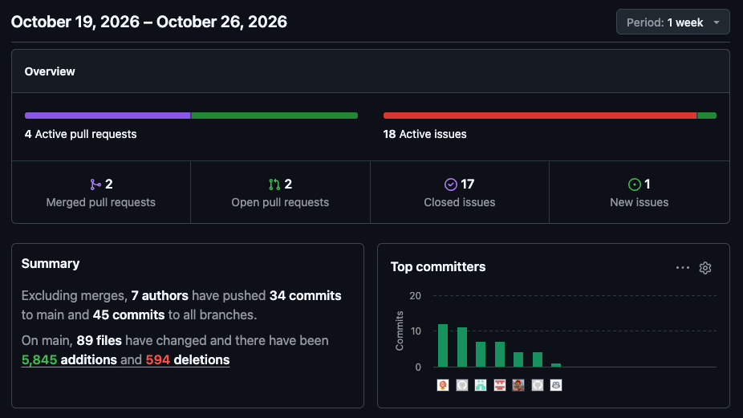

# Deliverable: Week 2 Progress Report & Implementation Decisions

**Project:** TECH5 Student-to-Project Assignment Decision Support System (DSS)  
**Team:** 6 (Groups 3 and 17 — 5 Members)  
**Repository:** [`mvs242430/TECH5-teams_3_17`](https://github.com/mvs242430/TECH5-teams_3_17)  
**Milestone:** Week 2 — *Implement, Integrate, and Replace Mock Engine*  
**Date:** 26 October 2026  

---

## 1. Week 2 Milestone & Requirements Checklist

All Week 2 functional, integration, and documentation goals are **100% complete on `main`**:

| Week 2 Requirement | Status | Evidence in Repository |
| :--- | :---: | :--- |
| **Team B implements the assignment approach in `solvers.py` and analytical metrics in `metrics.py`, replacing the mock engine.** | ✅ **Done** | [`app/engine/solvers.py`](../../app/engine/solvers.py), [`app/engine/strategies.py`](../../app/engine/strategies.py), and [`app/engine/metrics.py`](../../app/engine/metrics.py) fully implemented; `AssignmentEngine.execute_run` runs live Pyomo/HiGHS MILP optimization without falling back to `MockAssignmentEngine`. |
| **Team A implements the multi-solution comparison view and transparent recommendation logic.** | ✅ **Done** | [`app/visualization/routes.py`](../../app/visualization/routes.py), [`compare.html`](../../app/visualization/templates/compare.html), [`recommendations.html`](../../app/visualization/templates/recommendations.html), and [`solution_detail.html`](../../app/visualization/templates/solution_detail.html) render live side-by-side deltas, plain-language trade-offs, policy advice, and interactive **Lock & Rerun**. |
| **Both teams run automated integration tests to verify that real engine solutions flow smoothly into the user interface.** | ✅ **Done** | `.venv/bin/python -m pytest -q` $\rightarrow$ **`85 passed in 1.86s` (`0 failed`, `0 xfailed`)**, including all 15 baseline `xfail` tests plus 34 new unit/integration tests added by the team. |
| **Milestone: Solves real cohorts, retains multiple alternatives, and displays live comparisons without mock data.** | ✅ **Done** | Verified across all 4 Benchmark Scenarios (`standard`, `fixed`, `infeasible`, `conflicting`). Standard cohort generates 3 distinct Pareto solutions (`PREFERENCE`, `SKILL_FIT`, `BALANCED`) via integer no-good cuts. |
| **Deliverable: Report with details about implementation decisions and documentation.** | ✅ **Done** | Documented in Section 3 below and in 15 per-issue architectural decision logs under [`docs/team_related/issues_solutions/`](../team_related/issues_solutions/). |

---

## 2. Team Contributions & GitHub Insights

### 2.1 Member Responsibilities & Completed Work

| Member | Sub-Team & Role | Completed Tasks Merged to `main` | Key Files Delivered |
| :--- | :--- | :--- | :--- |
| **Julia** | **Team A (`A1`)** · Data Management, Validation & DB Docs | [`A1.2`](../team_related/issues_solutions/A1.2_solution.md) Projects CRUD & requirement matrix<br>[`A1.3`](../team_related/issues_solutions/A1.3_solution.md) Pre-solver UI validation & error banners<br>[`A1.4`](../team_related/issues_solutions/A1.4_solution.md) 3NF relational database documentation | [`routes.py`](../../app/visualization/routes.py), [`projects.html`](../../app/visualization/templates/projects.html), [`project_form.html`](../../app/visualization/templates/project_form.html), [`database_design.md`](../database_design.md) |
| **Tanver** | **Team A (`A2`)** · Comparison View, Recommendations & UX | [`A2.1`](../team_related/issues_solutions/A2.1_solution.md) Side-by-side `/compare` view & delta cards<br>[`A2.2`](../team_related/issues_solutions/A2.2_solution.md) Transparent `/recommendations/<run_id>` UI<br>[`A2.3`](../team_related/issues_solutions/A2.3_solution.md) Interactive **Lock & Rerun** workflow | [`routes.py`](../../app/visualization/routes.py), [`compare.html`](../../app/visualization/templates/compare.html), [`recommendations.html`](../../app/visualization/templates/recommendations.html), [`solution_detail.html`](../../app/visualization/templates/solution_detail.html) |
| **Daniel** | **Team B (`B1`)** · Analytical Metrics & Fairness | [`B1.1`](../team_related/issues_solutions/B1.1_solution.md) Skill-fit score & Gini inequality index<br>[`B1.2`](../team_related/issues_solutions/B1.2_solution.md) 4-pillar solution indicators<br>[`B1.3`](../team_related/issues_solutions/B1.3_solution.md) Pairwise solution trade-off comparator | [`app/engine/metrics.py`](../../app/engine/metrics.py), [`tests/test_metrics.py`](../../tests/test_metrics.py) |
| **Torkil** | **Team B (`B2`)** · MILP Optimization & Strategies | [`0.3`](../team_related/issues_solutions/0.3_solution.md) Pyomo & HiGHS solver setup<br>[`B2.1`](../team_related/issues_solutions/B2.1_solution.md) Base MILP model & `PreferenceOrientedSolver`<br>[`B2.2`](../team_related/issues_solutions/B2.2_solution.md) `SkillFitOrientedSolver` & `BalancedTradeoffSolver`<br>[`B2.3`](../team_related/issues_solutions/B2.3_solution.md) Integer no-good cuts for distinct alternatives | [`app/engine/strategies.py`](../../app/engine/strategies.py), [`requirements.txt`](../../requirements.txt), [`tests/test_solvers.py`](../../tests/test_solvers.py) |
| **Marie** | **Team B (`B3`)** · Engine Orchestration, Edge Cases & QA Integration | [`A1.1`](../team_related/issues_solutions/A1.1_solution.md) Skills CRUD & dependency checks<br>[`B3.1`](../team_related/issues_solutions/B3.1_solution.md) `AssignmentEngine.execute_run` orchestration<br>[`B3.2`](../team_related/issues_solutions/B3.2_solution.md) Contract & integration test activation<br>[`B3.3`](../team_related/issues_solutions/B3.3_solution.md) Infeasibility & validation diagnostics<br>[`B3.4`](../team_related/issues_solutions/B3.4_solution.md) All 15 solver & domain edge cases | [`app/engine/solvers.py`](../../app/engine/solvers.py), [`tests/test_edge_cases.py`](../../tests/test_edge_cases.py), [`tests/test_component_integration.py`](../../tests/test_component_integration.py), [`tests/test_contract_and_engine.py`](../../tests/test_contract_and_engine.py) |

### 2.2 Note on GitHub Insights



> **Why GitHub Insights displays 7 authors:**  
> Our team has **5 students** (Julia, Tanver, Daniel, Torkil, and Marie). GitHub Pulse counts **7 distinct commit identities** because:
> 1. Marie commited from 2 different accounts.
> 3. 1 commit from GitHub Copilot / starter setup.

---

## 3. Key Implementation & Architectural Decisions

### 3.1 Component B — Mathematical Optimization Engine (`app/engine/`)

| Decision Area | Chosen Approach | Rationale & Trade-Offs |
| :--- | :--- | :--- |
| **MILP Modeling & Solver (`0.3`, `B2.1`)** | **Pyomo (`pyomo>=6.7`) + HiGHS (`highspy>=1.7` / `appsi_highs`)** | Provides an industrial-grade, deterministic Mixed-Integer Linear Programming solver pip-installable across macOS and Windows without external C++ system dependencies. Solves our 10-student, 4-project cohort in `< 0.05s`. |
| **Class Placement (`solvers.py` vs. `strategies.py`)** | Keep `AssignmentStrategy` ABC in [`solvers.py`](../../app/engine/solvers.py); place concrete Pyomo strategies in [`strategies.py`](../../app/engine/strategies.py) | Preserves 100% compatibility with the starter carcass (`solvers.AssignmentStrategy`) while keeping the 370-line Pyomo model builder and 3 concrete strategy classes modular and conflict-free while B2 and B3 worked in parallel. |
| **3 Optimization Strategies (`B2.1`, `B2.2`)** | 1. `PreferenceOrientedSolver` (`"PREFERENCE"`): $w_{s,p} = M - r_{s,p} + 1$<br>2. `SkillFitOrientedSolver` (`"SKILL_FIT"`): $w_{s,p} = \text{fit}(s, p) \in [0, 1]$<br>3. `BalancedTradeoffSolver` (`"BALANCED"`): $\alpha \hat{f}_{\text{pref}} + (1-\alpha)\hat{f}_{\text{skill}}$ ($\alpha = 0.5$) | Normalizing preference utility $\hat{f}_{\text{pref}} \in [0, 1]$ and skill fit $\hat{f}_{\text{skill}} \in [0, 1]$ onto the same unit interval prevents preference rank magnitudes from dominating skill fit in the balanced strategy. |
| **Distinct Pareto Alternatives (`B2.3`, `B3.1`)** | **Strategy Rotation + Integer No-Good Cuts** ($\sum_{(s,p) \in A^{(k)}} x_{s,p} \le |S| - 1$) | In `execute_run`, the engine rotates across `PREFERENCE` $\rightarrow$ `SKILL_FIT` $\rightarrow$ `BALANCED` while accumulating `excluded_solutions`. This guarantees both multi-objective diversity on the Standard Scenario and strict non-duplication when two strategies share an unconstrained optimum (Edge Cases 14 & 15). |
| **Graceful Infeasibility Handling (`B2.1`, `B3.3`)** | `model.solver.solve(model, load_solutions=False)` + pre/post validation diagnostics | Calling `load_solutions=False` prevents Pyomo from raising `ValueError` when a model has no feasible solution. `execute_run` distinguishes `INFEASIBLE` (capacity deficit / impossible mandatory skill) from `INVALID_INPUT` (structural/contradictory locks) and persists actionable reasons in `run.diagnostics["reasons"]`. |
| **Skill-Fit & Fairness Metrics (`B1.1–B1.3`)** | Fractional capped skill fit $\min(\ell_{s,k}/m_{p,k}, 1.0)$; pairwise Gini coefficient; unranked penalty rank $M + 1$ | Prevents over-qualification in one skill from masking a deficit in another required skill; treating unranked assignments as $M + 1$ in fairness calculations prevents unranked allocations from artificially lowering `mean_rank`. |

### 3.2 Component A — Visualization, Comparison & Decision Support (`app/visualization/`)

| Decision Area | Chosen Approach | Rationale & Trade-Offs |
| :--- | :--- | :--- |
| **Side-by-Side Comparison (`/compare`, `A2.1`)** | 5 KPI Delta Cards ($\Delta$ Changed Students, $\Delta$ Skill Fit, $\Delta$ Mean Rank, $\Delta$ Gini, Rank Shifts) + Plain-Language Impact Box | Translates raw numerical deltas (`Solution B - Solution A`) into an immediately scannable **"Improves / Gets worse / Who is affected"** summary alongside the student-level reallocation table enriched with full student names and project titles. |
| **Transparent Recommendations (`/recommendations/<run_id>`, `A2.2`)** | 3 Policy Lenses (*Preference Maximization*, *Skill Quality*, *Egalitarian Fairness*) with separated **Criteria**, **Calculated Evidence**, and **Policy Advice** | Strictly separates objective mathematical facts computed by Component B from normative decision guidance, allowing coordinators to justify their chosen allocation transparently. Also added quick-jump recommendation badges directly on `/runs/<run_id>`. |
| **Interactive Lock & Rerun (`A2.3`)** | Single-click form on `/solutions/<id>` (`POST /solutions/<id>/lock-and-rerun`) preserving the original run's strategy and `max_alternatives` | Allows coordinators to pin a student-project pair from any candidate solution, persist it as an `APPROVED` `FixedAssignment`, and immediately re-optimize to inspect the ripple effect on peer students. |
| **Data Management & Referential Integrity (`A1.1–A1.3`)** | Sticky form state on validation errors, mandatory skill level auto-default ($\ge 1$), and pre-delete dependency checks | Prevents accidental deletion of skills still referenced by students or projects, and retains user input on validation failure instead of clearing forms via redirect. |

---

## 4. End-to-End Verification & Benchmark Results

### 4.1 Automated Test Suite (`85 passed, 0 xfailed`)

All **51 original starter tests** (including all 15 previously `xfailed` target tasks) plus **34 new unit and integration tests** pass:

```text
$ .venv/bin/python -m pytest -q
........................................................................ [ 84%]
.............                                                            [100%]
85 passed in 1.86s
```

| Test Module | Layer Verified | Result |
| :--- | :--- | :---: |
| [`tests/test_metrics.py`](../../tests/test_metrics.py) | Skill fit, Gini coefficient, 4-pillar solution indicators, pairwise solution comparison (`B1.1–B1.3`) | `17 passed` |
| [`tests/test_solvers.py`](../../tests/test_solvers.py) | Base MILP constraints, fixed locks, mandatory skills, 3 concrete strategies, integer no-good cuts (`B2.1–B2.3`, `B3.1–B3.2`) | `12 passed` |
| [`tests/test_edge_cases.py`](../../tests/test_edge_cases.py) | All 15 specification edge cases (incomplete/tied preferences, zero skills/requirements, capacity deficits, no-good cuts) (`B3.4`) | `15 passed` |
| [`tests/test_contract_and_engine.py`](../../tests/test_contract_and_engine.py) | `AssignmentEngineContract` compliance, validation outcomes, persistence & retrieval (`B3.1–B3.2`) | `5 passed` |
| [`tests/test_visualization_component.py`](../../tests/test_visualization_component.py) | RBAC, Skills & Projects CRUD, validation alerts, `/compare`, `/recommendations`, Lock & Rerun (`A1.1–A1.3`, `A2.1–A2.3`) | `28 passed` |
| [`tests/test_component_integration.py`](../../tests/test_component_integration.py) | Full lifecycle seed $\rightarrow$ solve $\rightarrow$ view $\rightarrow$ recommend $\rightarrow$ compare $\rightarrow$ lock & rerun + infeasible cohort flow | `2 passed` |
| [`tests/test_database_integrity.py`](../../tests/test_database_integrity.py) | SQLite 3NF schema constraints, foreign keys, cascades, and repository round-trips | `6 passed` |

### 4.2 Live Benchmark Scenarios Verification (Zero Mock Data)

| Scenario (`/scenarios`) | Engine Status | Alternatives Generated | Live Outcome & Trade-Offs |
| :--- | :---: | :---: | :--- |
| **1. Standard Trade-Off Benchmark** (`standard`) | `COMPLETED` | **3 Distinct Solutions** | • **Alt #1 (`PREFERENCE`):** Mean Rank `1.00`, Worst Rank `1`, Gini `0.0000`, Skill Fit `98.3%`<br>• **Alt #2 (`SKILL_FIT`):** Mean Rank `1.20`, Worst Rank `2`, Gini `0.1333`, Skill Fit `100.0%`<br>• **Alt #3 (`BALANCED`):** Mean Rank `1.10`, Worst Rank `2`, Gini `0.0818`, Skill Fit `100.0%` |
| **2. Fixed Assignment & Rerun** (`fixed`) | `COMPLETED` | **3 Distinct Solutions** | Strictly locks `S02` $\rightarrow$ `P2` (`is_fixed=True`) across all 3 alternatives and supports interactive Lock & Rerun. |
| **3. Capacity Deficit** (`infeasible`) | `INFEASIBLE` | `0` | Gracefully caught (`10 students > 6 seats`); persists run with diagnostic bottleneck explanation. |
| **4. Contradictory Locks** (`conflicting`) | `INFEASIBLE` | `0` | Rejects 4 fixed locks on `P1` (`max_capacity=3`) with explicit capacity-exceeded diagnostic error. |

---

## 5. Implementation Documentation Index

Detailed architectural rationale, data-flow walkthroughs, files changed, and verification logs for every implemented issue are maintained in [`docs/team_related/issues_solutions/`](../team_related/issues_solutions/):

- **Team A Solutions:** [`A1.1`](../team_related/issues_solutions/A1.1_solution.md) · [`A1.2`](../team_related/issues_solutions/A1.2_solution.md) · [`A1.3`](../team_related/issues_solutions/A1.3_solution.md) · [`A1.4`](../team_related/issues_solutions/A1.4_solution.md) · [`A2.1`](../team_related/issues_solutions/A2.1_solution.md) · [`A2.2`](../team_related/issues_solutions/A2.2_solution.md) · [`A2.3`](../team_related/issues_solutions/A2.3_solution.md)
- **Team B Solutions:** [`0.3`](../team_related/issues_solutions/0.3_solution.md) · [`B1.1`](../team_related/issues_solutions/B1.1_solution.md) · [`B1.2`](../team_related/issues_solutions/B1.2_solution.md) · [`B1.3`](../team_related/issues_solutions/B1.3_solution.md) · [`B2.1`](../team_related/issues_solutions/B2.1_solution.md) · [`B2.2`](../team_related/issues_solutions/B2.2_solution.md) · [`B2.3`](../team_related/issues_solutions/B2.3_solution.md) · [`B3.1`](../team_related/issues_solutions/B3.1_solution.md) · [`B3.2`](../team_related/issues_solutions/B3.2_solution.md) · [`B3.3`](../team_related/issues_solutions/B3.3_solution.md) · [`B3.4`](../team_related/issues_solutions/B3.4_solution.md)
