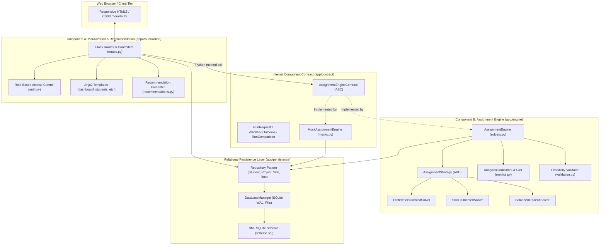
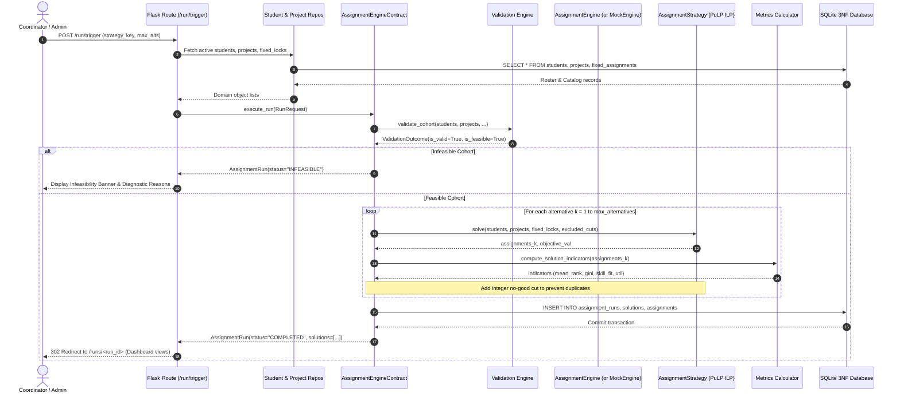
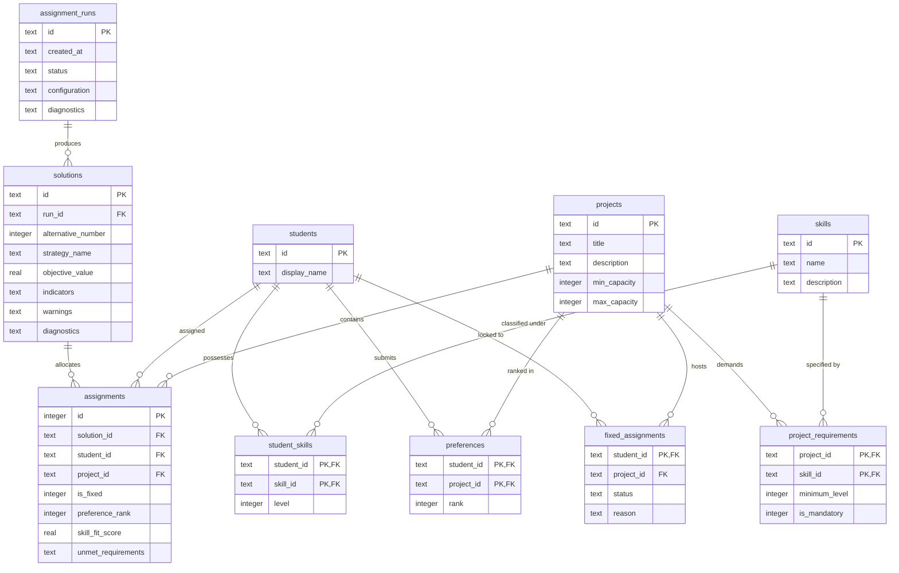

# TECH5 Decision Support System: Developer Onboarding & Architecture Guide

Welcome to the **TECH5 Student-to-Project Assignment Decision Support System (DSS)** codebase! This guide is written to help you quickly understand the project domain, software architecture, data structures, and daily developer workflows.

---

## 1. Domain & Business Overview

The application solves an academic combinatorial allocation problem: assigning a cohort of students ($S$) to semester research and capstone projects ($P$) under competing operational criteria:

1. **Student Ranked Preferences**: Students rank projects from choice 1 to $k$ (maximizing satisfaction / minimizing rank regret).
2. **Skill Competency Matching**: Students possess skill proficiencies; projects demand minimum required levels (mandatory vs. optional soft skills).
3. **Project Capacity Bounds**: Projects have hard minimum ($l_p$) and maximum ($u_p$) headcount quotas.
4. **Administrative Fixed Allocations**: Academic coordinators can lock specific student-to-project pairings (pre-allocation locks).
5. **Multi-Alternative Trade-offs**: Instead of forcing a single black-box assignment, the system generates distinct Pareto alternative solutions and provides transparent recommendations.

---

## 2. Architectural Paradigm: In-Process Two-Component Monolith

The codebase is explicitly designed as a **two-component modular monolith** within a single Python process, avoiding microservices or network APIs:

- **Component A: Visualization & Recommendation** ([`app/visualization`](../../app/visualization)):
  - Built with Flask, Jinja2 HTML5 templates, and CSS.
  - Handles UI workflows, cohort data inspection, student/project/skill CRUD, scenario loading, role switching (Admin, Coordinator, Student), and solution comparison.
- **Component B: Assignment Engine** ([`app/engine`](../../app/engine)):
  - Mathematical optimization algorithms and analytical metrics (Gini inequality, skill-fit scores, fairness).
  - Uses the **Strategy Pattern** ([`AssignmentStrategy`](../../app/engine/solvers.py#L23-L89)) for different objectives (Preference, Skill Fit, Balanced) and integer no-good cuts for alternative solutions.
- **Internal Component Contract** ([`app/contract/contract.py`](../../app/contract/contract.py)):
  - Defines [`AssignmentEngineContract`](../../app/contract/contract.py#L117-L195) (an Abstract Base Class) and strongly-typed Data Transfer Objects ([`RunRequest`](../../app/contract/contract.py#L95-L115), [`ValidationOutcome`](../../app/contract/contract.py#L62-L92), [`RunComparison`](../../app/domain/models.py#L637-L720)).
  - Includes a pluggable [`MockAssignmentEngine`](../../app/contract/mocks.py#L19-L260) with automatic fallback so Component A works end-to-end even before the mathematical solver is implemented.
- **Relational Persistence Layer** ([`app/persistence`](../../app/persistence)):
  - Thread-safe SQLite persistence with WAL mode and foreign-key constraints enabled via [`DatabaseManager`](../../app/persistence/database.py#L16-L124).
  - Domain repositories encapsulate database access ([`StudentRepository`](../../app/persistence/repositories.py#L73-L210), [`ProjectRepository`](../../app/persistence/repositories.py#L212-L330), [`SkillRepository`](../../app/persistence/repositories.py#L15-L71), [`FixedAssignmentRepository`](../../app/persistence/repositories.py#L332-L410), [`RunRepository`](../../app/persistence/repositories.py#L412-L698)).

---

## 3. System Architecture & UML Diagrams

### 3.1 UML Component Architecture Diagram



---

### 3.2 UML Class Diagram (Domain, Contract, and Engine)

```mermaid
classDiagram
    direction TB

    class Skill {
        +str id
        +str name
        +str description
        +to_dict() dict
        +from_dict(data)$ Skill
    }

    class ProjectRequirement {
        +str project_id
        +str skill_id
        +int minimum_level
        +bool is_mandatory
        +to_dict() dict
    }

    class Preference {
        +str student_id
        +str project_id
        +int rank
        +to_dict() dict
    }

    class Student {
        +str id
        +str display_name
        +dict skills
        +list~Preference~ preferences
        +get_preference_rank(project_id) int
        +get_skill_level(skill_id) int
        +to_dict() dict
    }

    class Project {
        +str id
        +str title
        +str description
        +int min_capacity
        +int max_capacity
        +list~ProjectRequirement~ requirements
        +to_dict() dict
    }

    class FixedAssignment {
        +str student_id
        +str project_id
        +str status
        +str reason
        +to_dict() dict
    }

    class Assignment {
        +str student_id
        +str project_id
        +bool is_fixed
        +int preference_rank
        +float skill_fit_score
        +list~str~ unmet_requirements
        +to_dict() dict
    }

    class Solution {
        +str id
        +str run_id
        +int alternative_number
        +str strategy_name
        +float objective_value
        +list~Assignment~ assignments
        +dict indicators
        +list~str~ warnings
        +get_assignment_for_student(student_id) Assignment
    }

    class AssignmentRun {
        +str id
        +str created_at
        +str status
        +dict configuration
        +list~Solution~ solutions
        +dict diagnostics
    }

    class RunRequest {
        +list~Student~ students
        +list~Project~ projects
        +list~Skill~ skills
        +list~FixedAssignment~ fixed_assignments
        +str strategy_key
        +int max_alternatives
    }

    class ValidationOutcome {
        +bool is_valid
        +bool is_feasible
        +list~str~ errors
        +list~str~ warnings
        +list~str~ infeasibility_reasons
    }

    class AssignmentEngineContract {
        <<interface>>
        +validate_inputs(request)* ValidationOutcome
        +execute_run(request)* AssignmentRun
        +list_runs(limit)* list~AssignmentRun~
        +get_run(run_id)* AssignmentRun
        +get_solution(solution_id)* Solution
        +compare_solutions(sol_a, sol_b)* RunComparison
    }

    class AssignmentEngine {
        -RunRepository run_repo
        -dict strategies
        +register_strategy(strategy)
        +validate_inputs(request) ValidationOutcome
        +execute_run(request) AssignmentRun
        +run_assignment(students, projects, ...) AssignmentRun
    }

    class MockAssignmentEngine {
        -RunRepository run_repo
        +validate_inputs(request) ValidationOutcome
        +execute_run(request) AssignmentRun
        +compare_solutions(sol_a, sol_b) RunComparison
    }

    class AssignmentStrategy {
        <<abstract>>
        +str name
        +str description
        +calculate_cost_or_utility(student, project, max_pref)* float
        +solve(students, projects, fixed_assignments, excluded)* tuple
    }

    Student "1" *-- "*" Preference
    Project "1" *-- "*" ProjectRequirement
    AssignmentRun "1" *-- "*" Solution
    Solution "1" *-- "*" Assignment
    AssignmentEngineContract <|.. AssignmentEngine
    AssignmentEngineContract <|.. MockAssignmentEngine
    AssignmentEngine o-- AssignmentStrategy
    AssignmentEngineContract ..> RunRequest : receives
    AssignmentEngineContract ..> ValidationOutcome : returns
```



---

### 3.3 UML Sequence Diagram: Optimization Run Execution

The following sequence details how an optimization run is initiated from the Web UI, dispatched across the internal contract, validated, solved, and persisted:



---

### 3.4 UML Entity-Relationship Diagram (Relational 3NF Database)



---

## 4. Current Repository Status & Test Suite

The test suite contains **51 tests** designed to guide step-by-step feature delivery:

| Status     | Count  | Description                                                                                                                                                                |
| ---------- | ------ | -------------------------------------------------------------------------------------------------------------------------------------------------------------------------- |
| **PASSED** | **36** | Domain models, 3NF database persistence, cohort validation, contract compliance, mock engine fallback, web dashboard, student/fixed locks workflows, and scenario runners. |
| **XFAIL**  | **15** | Expected failures representing target tasks for Team A and Team B.                                                                                                         |

### The 15 XFAIL Tasks Breakdown:

1. **Team A Tasks (3 xfails)**:
   - `test_skills_crud_workflow` ([`tests/test_visualization_component.py`](../../tests/test_visualization_component.py#L175-L194)): Skill creation POST endpoint.
   - `test_projects_crud_workflow` ([`tests/test_visualization_component.py`](../../tests/test_visualization_component.py#L196-L217)): Project creation with requirements.
   - `test_compare_solutions_view` ([`tests/test_visualization_component.py`](../../tests/test_visualization_component.py#L219-L230)): Side-by-side solution comparison route (`/compare`).
2. **Team B Tasks (12 xfails)**:
   - `test_gini_calculation`, `test_skill_fit_calculation`, `test_solution_indicators_calculation`, `test_solution_comparison` ([`tests/test_metrics.py`](../../tests/test_metrics.py)).
   - `test_distinct_alternatives_generation` ([`tests/test_solvers.py`](../../tests/test_solvers.py#L38-L71)).
   - 7 solver-dependent edge cases in [`tests/test_edge_cases.py`](../../tests/test_edge_cases.py).

---

## 5. Developer Daily Commands & Guidelines

### Run the Dev Server

```bash
python run.py [port]
# Defaults to http://127.0.0.1:5000
```

### Run Tests

```bash
.venv/bin/pytest -v
```

### Key Architectural Conventions

1. **Zero Microservices / Network Overheads**: Do not create internal HTTP APIs or REST microservices between components; all cross-component communication must go through [`AssignmentEngineContract`](../../app/contract/contract.py#L117-L195).
2. **Strict In-Process Decoupling**: Component B (`app/engine`) must NEVER import or reference Flask, HTTP request objects, sessions, or Jinja2. It must remain pure, headless Python.
3. **Mock Engine Fallback**: When real solver methods raise `NotImplementedError`, the web application automatically falls back to `MockAssignmentEngine` with an informative banner.
