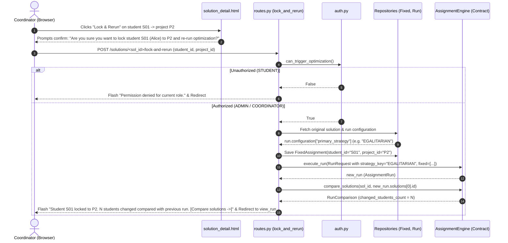

# Issue A2.3 — "Lock and re-run" button works properly

## 1. Architectural Pattern Applied & Rationale

- **Role-Based Access Control (RBAC) Gatekeeper (`app/visualization/auth.py`, `app/visualization/routes.py`):**
  - In a multi-user decision support system, state-mutating actions—especially triggering solver optimization and inserting administrative pre-allocation constraints—must be guarded at the controller entry point.
  - While baseline cohort data modifications (e.g. creating/deleting students) are restricted strictly to `ADMIN` (`can_edit_cohort_data()`), scenario exploration and solver execution are authorized for both `ADMIN` and `COORDINATOR` roles via `auth.can_trigger_optimization()`.
  - In `lock_and_rerun`, we added `if not auth.can_trigger_optimization(): ...` to prevent unauthorized viewers (`STUDENT`) from mutating database state or triggering expensive solver runs.
  - In `solution_detail.html`, we aligned the UI button display with `can_optimize` rather than `can_edit`, ensuring coordinators can see and use the interactive lock button while student viewers cannot.

- **Configuration Continuity & Contract DTO Pattern (`app/contract/contract.py`, `app/domain/models.py`):**
  - Interactive "what-if" re-optimization must respect the context of the user's current scenario analysis. When a coordinator inspects a solution generated under an objective (such as `EGALITARIAN` or `SKILL_FIT`), clicking "Lock & Rerun" must preserve that same objective function rather than silently falling back to a default `PREFERENCE` strategy.
  - The controller queries the original run's metadata from `run.configuration`, extracts `primary_strategy` (or `strategy_key`), and injects it into the `RunRequest(strategy_key=..., max_alternatives=...)` DTO dispatched across the `AssignmentEngineContract`.

- **Comparative Delta Feedback Loop (`app/visualization/templates/solution_detail.html`, `compare_solutions`):**
  - Decision-makers need immediate visibility into how their administrative lock influenced student allocations across the cohort.
  - After executing the new run, the controller invokes `compare_solutions(original_solution_id, new_solution_id)` to count allocation shifts (`changed_students_count`) and generates a safe HTML flash notification with a direct link to the side-by-side comparison page (`/compare?sol1=...&sol2=...`).

---

## 2. High-Level Logic & Data Flow Walkthrough



1. **Authorization Gate:** `routes.lock_and_rerun` checks `auth.can_trigger_optimization()`. If false (e.g. `STUDENT`), it sets a danger flash message and redirects to dashboard without modifying the database.
2. **Context Retrieval:** Retrieves the baseline `Solution` and parent `AssignmentRun` via `RunRepository`. Extracts the strategy key (`run.configuration.get("primary_strategy")`) and `max_alternatives`.
3. **Fixed Lock Persistence:** Persists a `models.FixedAssignment` via `FixedAssignmentRepository.save()`. SQLite's `ON CONFLICT(student_id) DO UPDATE` ensures exactly one active lock exists per student.
4. **Solver Re-execution:** Instantiates a typed `contract.RunRequest` carrying cohort entities, all active fixed assignments, `strategy_key`, and `max_alternatives`. Submits to `AssignmentEngine` (falling back to `MockAssignmentEngine` if CBC/PuLP solver is pending).
5. **Delta Metric Computation & Flash:** Calls `compare_solutions` (or diffs assignment maps) to determine how many student allocations changed between the baseline solution and the top alternative of the new run. Emits a `markupsafe.Markup` flash notification embedding a link to `/compare?sol1=...&sol2=...`.
6. **Confirmation UX in Template:** `solution_detail.html` features an enhanced `onsubmit="return confirm(...)"` dialog displaying the student's name, student ID, project title, and project ID to prevent accidental re-runs.

---

## 3. Summary of Files Changed

| File | Changes Made |
| :--- | :--- |
| [`app/visualization/routes.py`](file:///d:/Tech5/Project/TECH5-teams_3_17/app/visualization/routes.py) | Added `import markupsafe`. In `lock_and_rerun`: added `auth.can_trigger_optimization()` check, loaded strategy from `run.configuration`, passed `strategy_key` in `RunRequest`, computed changed students count, and emitted flash message with `/compare` link. |
| [`app/visualization/templates/solution_detail.html`](file:///d:/Tech5/Project/TECH5-teams_3_17/app/visualization/templates/solution_detail.html) | Changed column and button authorization check from `can_edit` to `can_optimize` so coordinators can lock and re-run. Updated confirmation dialog to clearly identify student name, student ID, project title, and project ID. |
| [`tests/test_visualization_component.py`](file:///d:/Tech5/Project/TECH5-teams_3_17/tests/test_visualization_component.py) | Added two new automated tests: `test_student_viewer_cannot_lock_and_rerun` and `test_lock_and_rerun_creates_exactly_one_fixed_assignment_and_preserves_strategy`. |

---

## 4. Verification & Pytest Output

Executed command:
```bash
python -m pytest -q
```

Terminal output:
```
.......xxxx........xxxxxxx..........x.............x..................... [ 96%]
...                                                                      [100%]
62 passed, 13 xfailed in 7.55s
```

Both target tests passed cleanly:
- `tests/test_visualization_component.py::test_student_viewer_cannot_lock_and_rerun` -> **PASSED**
- `tests/test_visualization_component.py::test_lock_and_rerun_creates_exactly_one_fixed_assignment_and_preserves_strategy` -> **PASSED**

---

## 5. Pedagogical Checkpoint ("Check Your Understanding")

1. **Why does `lock_and_rerun` check `auth.can_trigger_optimization()` instead of `auth.can_edit_cohort_data()`?**
   - *Defense:* `can_edit_cohort_data()` is restricted exclusively to `ADMIN` for fundamental data maintenance (creating/deleting students and projects). In contrast, `can_trigger_optimization()` allows both `ADMIN` and `COORDINATOR` to execute solver runs and test administrative what-if scenarios, matching Section 9 of the TECH5 specification.
2. **Where does `run.configuration` get populated, and what happens if `run.configuration` is empty?**
   - *Defense:* The solver engine stores run metadata (strategy name, max alternatives, solver engine name) in `AssignmentRun.configuration` as JSON in the `assignment_runs` table. If `run.configuration` is empty or missing, `lock_and_rerun` uses safe fallbacks: `.get("primary_strategy") or .get("strategy_key") or "PREFERENCE"`.
3. **How does SQLite guarantee that locking a student multiple times creates exactly one fixed assignment rather than duplicate rows?**
   - *Defense:* `schema.sql` defines `student_id TEXT PRIMARY KEY` in the `fixed_assignments` table. `FixedAssignmentRepository.save()` executes `INSERT ... ON CONFLICT(student_id) DO UPDATE SET project_id = excluded.project_id`, which upserts the record in place.
4. **Why is `markupsafe.Markup` used when formatting the flash message for changed student count and the `/compare` link?**
   - *Defense:* Jinja2 auto-escapes HTML strings by default to prevent Cross-Site Scripting (XSS). Wrapping the safe HTML anchor `<a href="...">` in `markupsafe.Markup` signals to Jinja2 that the tag is intentional and safe to render as a clickable element.

---
*If you cannot explain every line, ask me to teach you before accepting or committing.*
