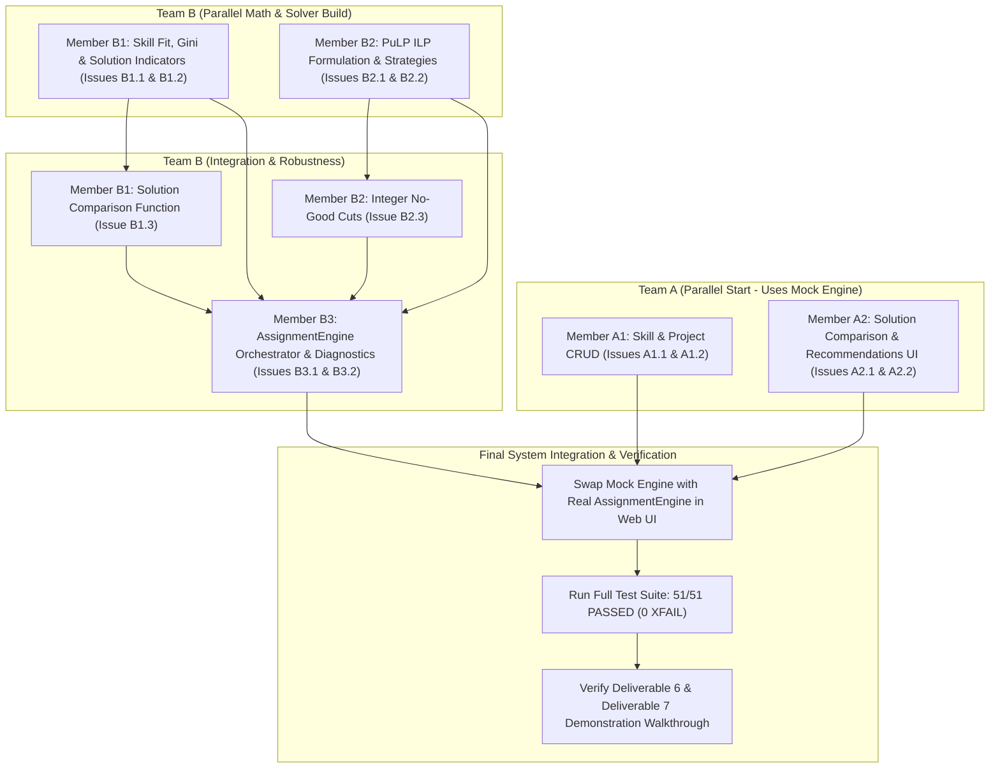

# TECH5 Collaborative Project: Team Task Allocation & Three-Week Milestone Plan

*Approved Master Operational Plan based on the official NHH student-facing challenge brief: **TECH5 Collaborative Project: The Student-to-Project Assignment Challenge**.*

---

## 1. High-Level Team Sizing & Allocation Strategy

* **Team A (2 Members):** Visualization and Recommendation Component (`app/visualization`)
* **Team B (3 Members):** Assignment Engine Component (`app/engine`)
* **Core Design Rule:** Closely coupled tasks (e.g. data forms + validation, or optimization formulation + integer cuts) are assigned to the **same person** to maintain conceptual integrity and eliminate merge friction.

| Team | Member | Role Title | Core Focus & Cohesive Tasks | Target Tests | Lead Deliverables |
|---|---|---|---|---|---|
| **Team A** | **Member A1** | **Data Management & Entity Specialist** | Student, Project, & Skill CRUD intake pipelines, dynamic requirements matrix, input validation | `test_skills_crud_workflow`, `test_projects_crud_workflow` | D1 (Progress Reports), D5 (Database & SQL) |
| **Team A** | **Member A2** | **Decision Support & UX Specialist** | Solution comparison view, metric delta cards, re-allocation diffs, recommendation presentation, RBAC | `test_compare_solutions_view` | D3 (Architecture), D8 (Reproducible Demo) |
| **Team B** | **Member B1** | **Analytical Indicators & Fairness Specialist** | Skill fit score $\bar{\sigma}$, Gini coefficient $G$, multidimensional indicators, comparison deltas | `test_gini_calculation`, `test_skill_fit_calculation`, `test_solution_indicators_calculation`, `test_solution_comparison` | D6 (Analytical Note: Indicators & Equations) |
| **Team B** | **Member B2** | **Optimization & Solvers Specialist** | PuLP ILP formulation, strategy pattern (`Preference`, `SkillFit`, `Balanced`), integer no-good cuts | `test_distinct_alternatives_generation`, ILP constraints | D6 (Analytical Note: Model & Constraints), Method Approval |
| **Team B** | **Member B3** | **Engine Orchestration & Robustness Specialist** | Main engine lifecycle, solver diagnostics, infeasibility root-causes, 7 solver edge cases | 7 edge cases in `test_edge_cases.py` (Cases 1, 2, 3, 4, 13, 14, 15) | D4 (Contract Spec), D7 (Testing & Quality Evidence) |

---

## 2. The Three-Week Journey & Weekly Milestones

```
┌────────────────────────────────────────────────────────────────────────┐
│ WEEK 1: Understand, Design, and Divide                                 │
│ Contract alignment, mock-driven UI start, mathematical formulation     │
└──────────────────────────────────┬─────────────────────────────────────┘
                                   │
┌──────────────────────────────────▼─────────────────────────────────────┐
│ WEEK 2: Make It Real                                                   │
│ Implement ILP solvers, indicators, comparison view & mock-engine swap  │
└──────────────────────────────────┬─────────────────────────────────────┘
                                   │
┌──────────────────────────────────▼─────────────────────────────────────┐
│ WEEK 3: Make It Robust and Explainable                                 │
│ 13+ edge cases, diagnostics, Deliverables 1–9, reproducible demo script│
└────────────────────────────────────────────────────────────────────────┘
```

### Week 1: Understand, Design, and Divide
* **Theme:** Component decoupling, baseline understanding, contract agreement, and data intake.
* **Team A Focus:**
  * Explore the starter application and database schema (`app/persistence/schema.sql`).
  * Implement Project and Skill management interfaces (CRUD).
  * Build interactive workflows against the provided [`MockAssignmentEngine`](../../app/contract/mocks.py) without waiting for Team B.
* **Team B Focus:**
  * Formalize the assignment problem mathematically (sets, indices, decision variables, constraints, objective functions).
  * Prepare the **Professor Approval Point** proposal for the chosen method (Integer Linear Programming via PuLP).
  * Implement domain validation logic and verify pre-flight feasibility checks.
* **Shared Activities:** Run the initial 51 automated tests (36 passing baseline, 15 xfailed target tasks).
* **Week 1 Milestone & Definition of Done:**
  1. Team A can create, edit, and delete projects and skills via web forms, and trigger mock assignment runs to preview comparisons.
  2. Team B has written the formal mathematical proposal, obtained instructor approval, and verified all input validation tests (`tests/test_validation.py`).
  3. **Deliverable 1 (Progress Report 1)** submitted reflecting Week 1 division and architectural decisions.

---

### Week 2: Make It Real
* **Theme:** Algorithmic implementation, indicator calculation, and live integration.
* **Team A Focus:**
  * Implement side-by-side solution comparison controller and view (`/compare`).
  * Display analytical deltas ($\Delta$ skill-fit, $\Delta$ rank, $\Delta$ Gini) and student re-allocation diffs.
  * Implement transparent recommendation presentation distinguishing evidence from advice.
* **Team B Focus:**
  * Implement the PuLP ILP solver with the 3 required strategies:
    1. `PreferenceOrientedSolver` (satisfaction / rank regret minimization).
    2. `SkillFitOrientedSolver` (competence matching).
    3. `BalancedTradeoffSolver` (Pareto scalarized compromise).
  * Implement sequential alternative generation via **integer no-good cuts** ($\sum_{(s,p) \in A^{(k)}} x_{s,p} \le |S| - 1$) to generate up to $K=3$ distinct solutions.
  * Implement all analytical indicators: Feasibility, Efficiency ($\bar{\sigma}$), Fairness ($\bar{r}, r_{\max}$, unranked count, and Gini $G$ / rank variance), and Capacity Utilization.
* **Shared Activities (The Mock Swap):**
  * Replace `MockAssignmentEngine` with real `AssignmentEngine`. Verify that real optimization results populate the database and display on the UI.
* **Week 2 Milestone & Definition of Done:**
  1. The application solves real student-project cohorts end-to-end in-process without relying on mock data.
  2. Multiple distinct alternatives ($K \ge 2$) are produced and compared side-by-side with live delta metrics.
  3. **Deliverable 1 (Progress Report 2)** submitted detailing solver integration and preliminary test results.

---

### Week 3: Make It Robust and Explainable
* **Theme:** Corner cases, failure modes, diagnostics, report documentation, and live demonstration.
* **Team A Focus:**
  * Audit Role-Based Access Control (RBAC): ensure `Student Viewer` has zero mutating privileges.
  * Refine the interactive "Pin Lock & Re-run" workflow on the solution view.
  * Prepare and rehearse the reproducible demonstration script covering the 4 mandatory scenarios.
* **Team B Focus:**
  * Systematically test and resolve all **13+ edge cases** from Section 9 (tied preferences, missing skills, zero-skill students, capacity deficits, contradictory locks, infeasibility handling, degenerate alternative search).
  * Enhance solver diagnostics: return clear root-cause explanations on infeasibility rather than unhandled crashes.
  * Complete Deliverable 6 (**Analytical Note**).
* **Shared Activities:** Full automated test suite passes with **100% pass rate (0 unexpected failures or regressions)**.
* **Week 3 Milestone & Definition of Done:**
  1. All 51 pytest tests pass cleanly (`51 passed, 0 xfailed`).
  2. Complete decision-support walkthrough operational: Data entry $\rightarrow$ Run triggering $\rightarrow$ Pareto comparison $\rightarrow$ Recommendation review $\rightarrow$ Fixed lock & rerun $\rightarrow$ Infeasible cohort diagnostics.
  3. All 9 official project deliverables finalized.

---

## 3. What Success Looks Like

Section 12 of the brief establishes that success is evaluated not merely by whether code executes, but by whether a real decision-maker (e.g. CEMS project coordinator at NHH) can **understand and trust** the system.

> *"Do not ask only: 'Does our code work?' Also ask: 'Would a real decision-maker understand and trust what our application is telling them?'"*

### The 9 Criteria of Success

| # | Criterion | Verification & Evidence in the Codebase |
|:---:|---|---|
| **1** | **We understand the decision problem** | The application acknowledges conflicting objectives (student happiness vs. project skill delivery) and makes trade-offs explicit rather than masking them behind a single score. |
| **2** | **We translate business requirements into software** | Domain models ([`Student`](../../app/domain/models.py#L189-L295), [`Project`](../../app/domain/models.py#L297-L375), [`Assignment`](../../app/domain/models.py#L424-L480)) represent capacities $[l_p, u_p]$, skill levels $1$–$5$, mandatory vs. soft requirements, and fixed locks. |
| **3** | **Components integrate through a clear contract** | Component A and Component B communicate strictly through [`AssignmentEngineContract`](../../app/contract/contract.py#L117-L195) via typed DTOs without network overhead. |
| **4** | **Assignments respect hard constraints** | Feasibility checks guarantee exact allocation ($\sum_p x_{s,p} = 1$), capacity limits, mandatory skill satisfaction, and fixed assignment preservation. |
| **5** | **We measure efficiency and fairness** | Concrete metrics implemented: mean skill-fit $\bar{\sigma} \in [0, 1]$, rank distribution, unranked count, worst rank $r_{\max}$, and Gini coefficient $G$ (or rank variance). |
| **6** | **Meaningful alternatives and trade-offs** | Generates up to $K=3$ distinct alternatives using integer no-good cuts. UI highlights: *What improves? What worsens? Who is affected?* |
| **7** | **Recommendations are transparent** | Recommendations explicitly separate calculated mathematical facts (evidence) from policy guidance (advice) across 3 priorities. |
| **8** | **Problematic situations handled predictably** | When infeasible or invalid, the system produces actionable diagnostic explanations instead of unexplained crashes. |
| **9** | **Sound software-engineering practice** | Normalized 3NF SQLite schema, repository pattern, strategy pattern, clean Git history, module-only imports, type hints, and full test suite. |

---

## 4. Detailed Task Allocation & Issue Breakdown

### Team A (2 Members): Visualization & Recommendation

#### Member A1: Data Management & Entity Specialist
* **Focus:** Data intake pipelines, relational CRUD forms, requirement matrices, and input sanity checks.
* **Assigned Issues:**
  1. **Issue A1.1: Skill Catalog Management**
     * Routes: `POST /skills/new`, `POST /skills/<id>/delete` in [`app/visualization/routes.py`](../../app/visualization/routes.py#L446-L475).
     * Template: Add creation form and catalog cards to [`skills.html`](../../app/visualization/templates/skills.html).
     * Target Test: Pass `test_skills_crud_workflow` in [`tests/test_visualization_component.py`](../../tests/test_visualization_component.py).
  2. **Issue A1.2: Project Catalog & Dynamic Requirement Matrix**
     * Routes: `POST /projects/new`, `POST /projects/<id>/edit`, `POST /projects/<id>/delete`.
     * Templates: Implement dynamic requirement matrix in [`project_form.html`](../../app/visualization/templates/project_form.html) (looping catalogued skills, inputs for minimum levels $1$–$5$, mandatory checkboxes) and project cards on [`projects.html`](../../app/visualization/templates/projects.html).
     * Target Test: Pass `test_projects_crud_workflow` in [`tests/test_visualization_component.py`](../../tests/test_visualization_component.py).
  3. **Issue A1.3: Cohort Intake Validation & Flash Guidance**
     * Graceful user feedback for invalid capacities ($min > max$, negative values) and missing skill IDs.
  4. **Deliverable Contributions:** Lead Deliverable 5 (Database Model & SQL UI Documentation); Co-lead Deliverable 1 (Progress Report 1).

#### Member A2: Decision Support, Comparison & UX Specialist
* **Focus:** Multi-solution visualization, trade-off comparisons, transparent recommendations, and live demonstration.
* **Assigned Issues:**
  1. **Issue A2.1: Side-by-Side Solution Comparison View**
     * Route: `GET /compare?sol1=<id>&sol2=<id>` in [`app/visualization/routes.py`](../../app/visualization/routes.py#L776-L786).
     * Template: Build [`compare.html`](../../app/visualization/templates/compare.html) with:
       * Metric delta cards ($\Delta \bar{\sigma}, \Delta \bar{r}, \Delta G$).
       * Re-allocation diff table detailing each student assigned a different project.
     * Target Test: Pass `test_compare_solutions_view` in [`tests/test_visualization_component.py`](../../tests/test_visualization_component.py).
  2. **Issue A2.2: Transparent Recommendation Presentation & Pin-Lock UX**
     * Wire [`recommendations.html`](../../app/visualization/templates/recommendations.html) distinguishing mathematical evidence from policy advice across 3 priorities.
     * Refine the interactive "Pin lock and re-run" workflow on [`solution.html`](../../app/visualization/templates/solution.html).
  3. **Issue A2.3: RBAC Audit & Reproducible Demonstration Script**
     * Verify `Student Viewer` role masks all mutating buttons.
     * Author the complete demonstration script in [`docs/reproducible_demonstration.md`](../reproducible_demonstration.md) covering the 4 required scenarios from Section 11:
       1. Trade-off between alternatives.
       2. Transparent recommendation.
       3. Fixed assignment and immediate re-run.
       4. Invalid or infeasible input scenario.
  4. **Deliverable Contributions:** Lead Deliverable 8 (Reproducible Application Demonstration); Lead Deliverable 3 (System Architecture Specification).

---

### Team B (3 Members): Assignment Engine

#### Member B1: Analytical Indicators & Fairness Specialist
* **Focus:** Mathematical definitions and calculations of efficiency, fairness, capacity utilization, and comparative deltas.
* **Assigned Issues:**
  1. **Issue B1.1: Skill-Fit Scoring & Gini Coefficient Calculation**
     * In [`app/engine/metrics.py`](../../app/engine/metrics.py):
       * `calculate_assignment_skill_fit(student, project)`: Compute requirement qualification ratio $\min(\frac{\text{student\_level}}{\text{req\_level}}, 1.0)$, returning normalized score in $[0.0, 1.0]$ and unmet skill IDs.
       * `calculate_gini(values)`: Implement Gini index of preference rank distribution ($G \in [0.0, 1.0]$) with zero-division safety.
     * Target Tests: Pass `test_gini_calculation` and `test_skill_fit_calculation` in [`tests/test_metrics.py`](../../tests/test_metrics.py).
  2. **Issue B1.2: Multidimensional Solution Indicators**
     * Implement `compute_solution_indicators(...)` across all 4 mandatory dimensions:
       * *Feasibility:* Exact allocation, capacity compliance, mandatory skills, fixed locks.
       * *Efficiency:* Mean skill-fit score $\bar{\sigma}$, unmet soft requirements count.
       * *Fairness:* Rank distribution, mean rank $\bar{r}$, worst rank $r_{\max}$, unranked count, rank variance, Gini coefficient $G$.
       * *Capacity:* Aggregate cohort utilization %, per-project utilization.
     * Target Test: Pass `test_solution_indicators_calculation` in [`tests/test_metrics.py`](../../tests/test_metrics.py).
  3. **Issue B1.3: Comparative Solution Deltas & Trade-off Summaries**
     * Implement `compare_two_solutions(solution_a, solution_b)` returning distinctness boolean, student movement count, metric deltas, and natural-language trade-off summaries.
     * Target Test: Pass `test_solution_comparison` in [`tests/test_metrics.py`](../../tests/test_metrics.py).
  4. **Deliverable Contributions:** Author Sections 3 and 4 of Deliverable 6 ([`docs/analytical_note_template.md`](../analytical_note_template.md)): Mathematical definition of all indicators, fairness justification, and delta equations.

#### Member B2: Mathematical Optimization & Solvers Specialist
* **Focus:** Mathematical formulation, PuLP ILP solver implementation, objective strategies, and integer no-good cuts.
* **Assigned Issues:**
  1. **Issue B2.1: Mathematical Formulation & Instructor Approval Proposal**
     * In Week 1, write the formal proposal note for the **Professor Approval Point** justifying Integer Linear Programming (PuLP/CBC).
     * Formulate binary decision variables $x_{s,p} \in \{0, 1\}$ and hard constraints:
       $$\sum_{p \in P} x_{s,p} = 1 \quad \forall s \in S \quad (\text{exact allocation})$$
       $$l_p \le \sum_{s \in S} x_{s,p} \le u_p \quad \forall p \in P \quad (\text{capacity bounds})$$
       $$x_{s,p} = 1 \quad \forall (s,p) \in F \quad (\text{fixed administrative locks})$$
       $$x_{s,p} = 0 \quad \text{if student } s \text{ lacks mandatory skill for project } p$$
  2. **Issue B2.2: Concrete Assignment Strategies (Strategy Pattern)**
     * In [`app/engine/solvers.py`](../../app/engine/solvers.py), implement concrete subclasses of [`AssignmentStrategy`](../../app/engine/solvers.py#L23-L89):
       * `PreferenceOrientedSolver`: Maximizes rank satisfaction (or minimizes rank regret).
       * `SkillFitOrientedSolver`: Maximizes total skill qualification fit.
       * `BalancedTradeoffSolver`: Pareto scalarized convex combination.
  3. **Issue B2.3: Sequential Pareto Alternative Generation via No-Good Cuts**
     * Implement integer no-good cuts: after finding solution $A^{(k)}$, append:
       $$\sum_{(s,p) \in A^{(k)}} x_{s,p} \le |S| - 1$$
     * Re-solve up to $K=3$ distinct alternatives. If no further feasible solution exists, terminate honestly without manufacturing duplicate solutions.
     * Target Test: Pass `test_distinct_alternatives_generation` in [`tests/test_solvers.py`](../../tests/test_solvers.py).
  4. **Deliverable Contributions:** Lead Deliverable 6 ([`docs/analytical_note_template.md`](../analytical_note_template.md)): Formal notation, decision variables, objectives, and constraint equations; Co-lead Deliverable 1 (Progress Report 2).

#### Member B3: Engine Orchestration, Diagnostics & Edge Cases Specialist
* **Focus:** Main engine lifecycle execution, solver diagnostics, infeasibility detection, and test suite verification across all Section 9 edge cases.
* **Assigned Issues:**
  1. **Issue B3.1: Main Engine Orchestration (`AssignmentEngine.execute_run`)**
     * Wire [`AssignmentEngine.execute_run`](../../app/engine/solvers.py#L91-L255) to fulfill [`AssignmentEngineContract`](../../app/contract/contract.py#L117-L195):
       * Pre-flight cohort validation.
       * Solver loop invoking Member B2's strategy and cuts.
       * Indicator computation invoking Member B1's metrics.
       * Relational persistence of `AssignmentRun`, `Solution`, and `Assignment` via `RunRepository`.
  2. **Issue B3.2: Solver Diagnostics & Infeasibility Root-Cause Analysis**
     * Capture [`DiagnosticInfo`](../../app/contract/contract.py#L26-L59): solve time, variable count, constraint count.
     * Infeasibility reporting: identify specific bottlenecks (e.g. aggregate capacity shortfall, contradictory student locks, unavailable mandatory qualifications).
  3. **Issue B3.3: Systematic Edge Case Verification (The 7 Solver Edge Cases)**
     * Verify and pass the 7 solver-dependent tests in [`tests/test_edge_cases.py`](../../tests/test_edge_cases.py):
       * `test_edge_case_1`: Incomplete student preferences.
       * `test_edge_case_2`: Tied preferences across students.
       * `test_edge_case_3`: Student with zero recorded skills.
       * `test_edge_case_4`: Project with zero skill requirements.
       * `test_edge_case_13`: Provably infeasible problem instance.
       * `test_edge_case_14`: Exactly one feasible solution exists (cuts cleanly terminate).
       * `test_edge_case_15`: Duplicate avoidance under degenerate alternative search.
     * Target: Transition all 7 XFAILs in `test_edge_cases.py` to PASS.
  4. **Deliverable Contributions:** Lead Deliverable 7 (Testing, Quality, and Robustness Evidence); Lead Deliverable 4 (Component Contract Documentation); Author Sections 5, 6, and 7 of Deliverable 6.

---

## 5. Deliverables Mapping Across Team Members

The 9 required deliverables from Section 11 of the brief are distributed as follows:

| Deliverable | Description | Lead Owner | Contributing Members | Target Milestone |
|---|---|---|---|:---:|
| **D1: Progress Reports** | Brief progress reports after Week 1 and Week 2 | Member A1 | Member B2 | Weeks 1 & 2 |
| **D2: Working Application** | Integrated Flask + SQLite application with real engine | Member B3 & Member A2 | All members | Week 2 |
| **D3: Architecture & Design** | Component & class diagrams with design rationale | Member A2 | Member B3 | Week 1 |
| **D4: Component Contract** | Contract specification & integration documentation | Member B3 | Member A1 | Week 1 |
| **D5: Database & SQL** | 3NF model documentation & analytical queries | Member A1 | Member B1 | Week 2 |
| **D6: Analytical Note** | Mathematical report (formulation, indicators, advice) | Member B2 (Formulation) | Member B1 (Indicators), Member B3 (Diagnostics) | Week 3 |
| **D7: Testing Evidence** | Unit, integration, and edge-case test evidence | Member B3 | Member A1, Member B1 | Week 3 |
| **D8: Reproducible Demo** | Demonstration walkthrough script (4 core scenarios) | Member A2 | Member B2 | Week 3 |
| **D9: Team Reflection** | Collaborative practice, Git, AI tools, SDLC lessons | All members | All members | Week 3 |

---

## 6. Weekly Delivery Roadmap per Member

```
┌──────────┬─────────────────────────────┬─────────────────────────────┬─────────────────────────────┐
│ Member   │ Week 1                      │ Week 2                      │ Week 3                      │
├──────────┼─────────────────────────────┼─────────────────────────────┼─────────────────────────────┤
│ A1       │ Skills & Projects CRUD forms│ Dynamic Requirement Matrix  │ D5 SQL docs & UI error audit│
│ A2       │ Mock UI flow & RBAC review  │ Side-by-side /compare view  │ D8 Reproducible Demo script │
│ B1       │ Metric equations & Gini plan│ Skill-fit, Gini & Indicators│ D6 Indicator equations & deltas│
│ B2       │ Approval proposal & ILP math│ PuLP Solvers & No-Good Cuts │ D6 Formulation & cuts report│
│ B3       │ Validation tests audit      │ execute_run & persistence   │ 7 edge cases & diagnostics  │
└──────────┴─────────────────────────────┴─────────────────────────────┴─────────────────────────────┘
```

---

## 7. Execution Order & Cross-Team Synchronization



### Key Synchronization Gates:
1. **Gate 1 (End of Week 1):** Team B delivers approved ILP formulation proposal; Team A verifies that Project and Skill forms can seed a test cohort and trigger mock comparisons.
2. **Gate 2 (Mid-Week 2):** Team B provides working `AssignmentEngine`; Team A performs the **Mock Swap** and verifies that `/compare` displays real solver output with Pareto alternatives.
3. **Gate 3 (End of Week 3):** Full team conducts the 4-scenario reproducible demonstration walkthrough in a dry-run rehearsal before final submission.
